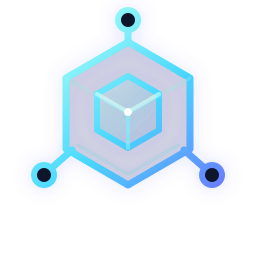
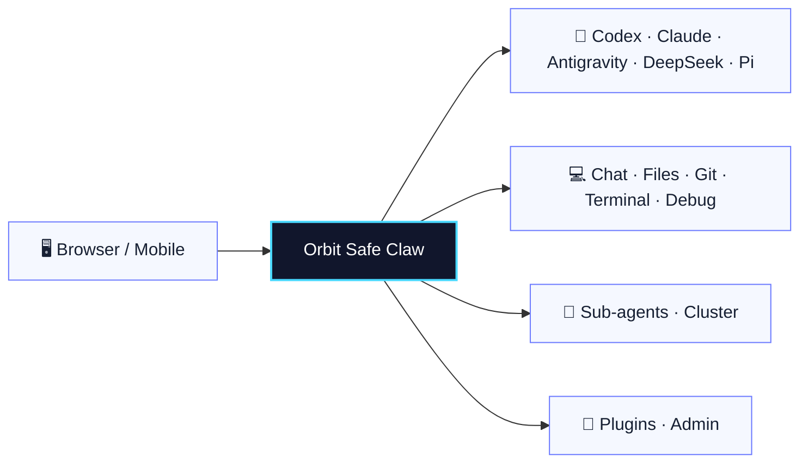

<p align="center">
  
</p>

<p align="center">
  <a href="README.md">简体中文</a> · <strong>English</strong>
</p>

<h1 align="center">Orbit Safe Claw</h1>

<p align="center">
  <strong>A self-hosted, multi-workspace AI development console for controlling Codex, Claude, Antigravity, DeepSeek Harness, and Pi from your browser.</strong>
</p>

<p align="center">
  Chat · Files · Git · Terminal · Debug · Plugins · Multi-agent Cluster
</p>

<p align="center">
  <a href="#quick-start">Quick Start</a> ·
  <a href="https://github.com/Augustusjk2008/telegram-cli-bot/releases/latest">Download</a> ·
  <a href="#feature-tour">Feature Tour</a> ·
  <a href="#advanced-configuration">Advanced Configuration</a> ·
  <a href="#license-branding-and-contributions">License</a> ·
  <a href="https://github.com/Augustusjk2008/telegram-cli-bot/issues">Report an Issue</a>
</p>

<p align="center">
  <a href="https://github.com/Augustusjk2008/telegram-cli-bot/releases/latest"></a>
  
  
  
  <a href="LICENSE"></a>
</p>

> [!NOTE]
> Orbit Safe Claw connects local AI CLIs, workspaces, and development tools to a remotely accessible web workbench, making multiple repositories, bots, sessions, and sub-agents easier to manage from one place. Model services and authentication come from the selected CLI or Pi configuration.

## At a Glance



<table>
  <tr>
    <td width="33%" valign="top"><strong>🤖 Multiple Bots and Sessions</strong><br><br>Each bot can use its own CLI, working directory, execution mode, and sessions. Agent scopes remain isolated, while web accounts authorized for the same bot share conversations.</td>
    <td width="33%" valign="top"><strong>🧰 Integrated Development Workbench</strong><br><br>Chat, edit files, inspect Git, use terminals, debug, and preview plugin content without constantly switching windows or context.</td>
    <td width="33%" valign="top"><strong>🧭 Sub-agents and Clusters</strong><br><br>Split review, implementation, and verification across sub-agents, routing rules, and cluster workflows, then collect results centrally.</td>
  </tr>
  <tr>
    <td valign="top"><strong>⚡ CLI and Native Execution</strong><br><br>Codex, Claude, Antigravity, and DeepSeek Harness use CLI streams; the native Pi agent uses AG-UI and preserves tool calls, permission requests, and context usage.</td>
    <td valign="top"><strong>🧩 Extensible Plugin Runtime</strong><br><br>Use <code>plugin.json</code> to add file viewers, settings pages, background processes, and full session-oriented views.</td>
    <td valign="top"><strong>🔒 Local-first and Self-managed</strong><br><br>Keep workspaces, sessions, configuration, and runtime data on your own devices, with user permissions, announcements, and update management included.</td>
  </tr>
</table>

## Quick Start

### Windows: Portable Edition Recommended

> [!TIP]
> The Windows portable package includes Python, Node.js, Git, the Pi CLI, Pi extensions, and the built frontend. Extract it and start immediately. Install and configure Codex, Claude, Antigravity, or DeepSeek Harness separately when using those CLIs.

1. Open [GitHub Releases](https://github.com/Augustusjk2008/telegram-cli-bot/releases/latest).
2. Download `orbit-safe-claw-windows-x64-<version>.zip` and extract it to a writable directory.
3. Double-click `start.bat`, or run:

   ```powershell
   .\start.bat
   ```

4. Open the web address shown in the console, normally `http://127.0.0.1:8765`. Direct loopback access provides the local administrator identity, which can create registration codes in Admin Center. The login page uses a username and password; registration requires a code, and guest access is read-only.

For the conventional installer flow, download `orbit-safe-claw-windows-x64-installer-<version>.zip`, extract it, and run `install.bat`.

### Linux / macOS

| Platform | Installation |
|---|---|
| Linux x64 | Download `orbit-safe-claw-linux-x64-<version>.tar.gz`, extract it, then run `bash install.sh` |
| macOS | Download `orbit-safe-claw-macos-universal-<version>.tar.gz`, extract it, then run `bash install.sh` |

Extract into a dedicated directory:

```bash
mkdir orbit-safe-claw
tar -xzf orbit-safe-claw-<platform>-<version>.tar.gz -C orbit-safe-claw
cd orbit-safe-claw
bash install.sh
bash start.sh
```

Linux and macOS require Python 3.10+, Git, and Node.js 22.13+ to satisfy the locked frontend dependencies. The native Pi agent also needs bash. Installers currently check only for Node.js 18+, so verify the actual Node version before installation.

<details>
<summary><strong>Install from a source snapshot</strong></summary>

Windows:

```powershell
$zip="$env:TEMP\orbit-safe-claw.zip"
Invoke-WebRequest "https://github.com/Augustusjk2008/telegram-cli-bot/archive/refs/heads/master.zip" -OutFile $zip
Expand-Archive $zip -DestinationPath . -Force
Set-Location .\telegram-cli-bot-master
.\install.bat
```

Linux/macOS:

```bash
curl -L https://github.com/Augustusjk2008/telegram-cli-bot/archive/refs/heads/master.tar.gz \
  | tar -xz
cd telegram-cli-bot-master
bash install.sh
```

</details>

## Feature Tour

### Multi-workspace Agent Control

- Bind the primary bot and managed bots to different repositories, CLIs, and working directories.
- Web sessions are isolated by bot, shared user domain, and agent; web accounts authorized for the same bot share the corresponding agent conversation.
- Codex (exec / app-server), Claude, Antigravity, and DeepSeek Harness CLI sessions retain streaming text, status events, traces, and completion events. Model lists and parameters are saved separately for each CLI type.
- The native Pi agent retains sessions, tool calls, permission requests, context usage, and execution details.

### SSH remote workspaces

When creating an agent, select **Remote SSH**, choose Linux / POSIX or Windows, enter the SSH connection details, verify the first connection's host key fingerprint, and browse to a remote directory. Remote agents support chat, a file tree, UTF-8 text editing, file uploads, and independent SSH terminal tabs. The remote host needs SSH/SFTP; AI CLIs and Pi run on the Orbit host. DeepSeek Harness currently supports local workspaces only.

Local control directories default to `~/.tcb/orbit-safe-claw/remote-workspaces/` (respecting `TCB_DATA_DIR`) and contain generated `AGENTS.md` and `CLAUDE.md` instructions. Project files stay remote. Agent tools, file operations, and terminals reuse SSH connections; tools support command batches, bounded file ranges, and exact text edits.

Uploads from the file panel write to the remote workspace. Chat attachments are saved under `attachments/` in the local control directory for the local agent to process.

Passwords and key passphrases remain in service memory; use **SSH sign in again** after restarting the service. Private key paths refer to the Orbit host. Text files are limited to 2 MiB. Remote workspaces currently omit language services, plugins, debugging, and workspace rollback. Create another agent to use a different remote directory. File APIs stay within the selected root; commands and terminals use the SSH account's permissions, and local CLI tools retain their existing permission settings.

The remote Git panel supports Linux and Windows repositories when the selected directory is the repository root. It provides status, diffs including untracked files, branches, commit graphs and history, staging, commits, initialization, discard, branch creation/switch/reset, stash listing/apply/drop/pop, fetch/pull/push, identity settings, commit-message generation, and smart commits. Stash creation is currently unavailable. Git operations run on the remote host and use its Git identity and credentials. Remote agents use the project's real Git history; shadow Git history and workspace rollback are unavailable.

Git must be available in the SSH account's non-interactive PATH. Missing Git, upstream configuration, or credentials produce diagnostics; Orbit does not install remote software. Fetch, pull, and push disable interactive credential prompts. After a write times out or loses its connection, refresh the state before retrying.

Windows targets need SSH/SFTP and `powershell.exe` (Windows PowerShell 5.1). Project tools such as Git, rg, and compilers must be on the remote account's PATH. Drive paths such as `C:\Projects\demo`, `C:/Projects/demo`, and `/C:/Projects/demo` are normalized to `/C:/Projects/demo`. File APIs reject UNC/device paths, alternate data streams, and junctions/symlinks. Windows 7 SP1 targets require compatible SSH/SFTP and PowerShell 5.1 installations; their terminal behavior and process cleanup still need verification on the actual machine. This compatibility scope applies to the remote target; the Orbit host requires a supported current runtime.

Windows text saves preserve UTF-8 BOM / CRLF, check for content conflicts, and replace files through a temporary file in the same directory while preserving ACLs. Failed replacements or disconnected writes may leave `.orbit-*.tmp` and `.bak` recovery files; inspect the target and recovery paths before retrying.

### Desktop Workbench

- **Chat**: regular CLI and native-agent conversations, history recovery, execution details, and context status.
- **Files**: file tree, editor, previews, tabs, and language-service navigation.
- **Git**: repository status, diffs, commit history, and workspace operations.
- **Terminal**: persistent multi-tab web terminals, with an independent shell and owner for every tab.
- **Debug**: debugging entry points for Python, C/C++, Godot, and generic DAP adapters.
- **Plugins**: extensible viewers for PDF, DOCX, PPTX, CSV, Vivado waveforms, and more.

### Local HTML Preview

The desktop workbench, chat file links, and mobile preview support interactive local HTML, including JavaScript, ES Modules, styles, images, fonts, relative JSON requests, project links, and hash routes. Use relative resource URLs; Vite builds need `base: "./"`. Each preview remains bound to its original resource directory. Remote SSH workspaces use a static HTML preview.

HTML files are limited to 1 MiB and individual resources to 16 MiB. The preview sandbox isolates the page from the console DOM, login credentials, and management APIs. Hidden directories, sensitive configuration, directory listings, server-side form submissions, external sites, development-server proxies, hot reload, persistent storage, and Service Workers are unavailable.

The toolbar supports refresh, return to the entry page, and retry. Resources are not cached. Preview tickets expire after 15 minutes and are revoked when the preview closes; retry after expiry or a workspace change to create a new ticket.

### Sub-agent and Cluster Collaboration

- Regular chats can select an explicit `agent_id` and use an isolated agent session; cluster templates prepare bot-level parallel slots and model tiers.
- Cluster tools cover dynamic team configuration, status checks, fresh sub-agent sessions, asynchronous task creation, polling, and message waiting.
- Once bot-level clustering is enabled, the main agent delegates through the shared `tcb-cluster` tool surface. Codex (exec / app-server) and Claude inject stdio MCP; Antigravity configures workspace MCP; DeepSeek Harness loads MCP through `--patch` on cluster turns; Pi adapts the same bridge through an extension.
- All these backends support local clusters. Remote Antigravity cluster orchestration is unavailable, and DeepSeek Harness is limited to local CLI execution. A user-managed `tcb-cluster` entry in an Antigravity workspace is reported as a configuration conflict and must be resolved first.
- Ordinary turns in the same main conversation retain the current team and `run_id`; an actual team change returns a new ID. Tasks and progress are kept in memory, so running sub-agent tasks do not resume after a host restart.

### Single Telegram Gateway

One Telegram bot routes messages to enabled Web Bot aliases. Configure it in Admin Center's environment settings or the project `.env`:

```env
TELEGRAM_ENABLED=true
TELEGRAM_BOT_TOKEN=<token-from-BotFather>
TELEGRAM_ALLOWED_USER_IDS=123456789,987654321
TELEGRAM_BROADCAST_COMPLETIONS=false
```

Restart the application after saving these settings. The gateway accepts private text messages from the Telegram numeric user-ID allowlist, which is separate from Web `ALLOWED_USER_IDS`. An empty allowlist disables access. The bot token is treated as a secret and is not stored in the Telegram state database or logs.

By default, selecting a bot/agent, sending a message, or opening its panel binds the Telegram private chat to that conversation. Final Web replies for the same `alias + agent_id + conversation_id` are then delivered once to Telegram. Intermediate status, traces, and cluster child-task progress are omitted. Switching Web conversations does not move the binding; open the Telegram panel again or start a new conversation there to bind the new one.

Enable `TELEGRAM_BROADCAST_COMPLETIONS` to notify every allowlisted private-chat user of final Web or Telegram replies. The originating Telegram chat receives its direct reply once. Other recipients receive a completion notification; long replies begin with a preview that can be expanded with the button or by replying `/expand`. Users bound to that conversation also receive continue, new-conversation, and open-Web actions. Delivery retries and expansion read persisted replies without executing the agent task again.

Replies render Markdown headings, emphasis, strikethrough, lists, quotes, links, and code as Telegram rich text and split long messages into segments. Delivery progress and full replies are persisted so unsent segments can resume after a service restart.

| Command | Action |
|---|---|
| `/start`, `/help` | List agents and quick actions |
| `to dev analyze this issue` | Send to `dev`'s current shared conversation |
| `to dev /new` | Start a new conversation while retaining history |
| `/config dev` | Show execution mode, model, reasoning effort, and cluster state |
| `/config dev model <value>` | Set the active mode's model |
| `/config dev reasoning <value>` | Set reasoning effort |
| `/config dev cluster on\|off` | Toggle bot-level clustering |
| `/expand` | Expand the replied-to preview, or the latest preview when sent alone |

The keyboard also provides status, stop, configuration, and help actions. Model choices follow the active CLI or Pi configuration. Changes apply to the next turn; active tasks keep their initial configuration. Telegram and Web share `(Bot, shared user, agent)` sessions and history, and Telegram cancellation uses the Web task and cluster cancellation flow. Open-Web actions require `WEB_PUBLIC_URL` or fixed public forwarding with the `/node/<node-id>/` prefix preserved. Check the token, allowlist, application restart, competing `getUpdates` clients, public URL, and WebSocket proxy when troubleshooting.

### Administration and Extensions

- Admin Center manages user permissions, invite codes, announcements, updates, and runtime status.
- Theme management shares one library and selected theme across accounts. Signed-in member accounts can copy, edit, apply, and delete custom themes; guests have read-only access. Copy the built-in Paper Day theme to customize and preview its colors.
- Codex CLI usage can be aggregated by local calendar day, provider, and model.
- Cloudflare quick tunnels and fixed public forwarding support controlled mobile access.

## Support Matrix

### Release Packages

| Package | Best for | Runtime |
|---|---|---|
| Windows portable | Fast setup and portable/offline use | Bundles Python, Node.js, Git, Pi CLI, and frontend assets |
| Windows installer | Conventional local installation | Installer checks and prepares dependencies |
| Linux x64 | Self-hosting on Linux | Uses system Python, Node.js, and Git |
| macOS universal | macOS source package | Uses system Python, Node.js, and Git |

### Execution Modes

| Mode | Primary target | Transport and presentation |
|---|---|---|
| `cli` | Codex exec / app-server, Claude, Antigravity, DeepSeek Harness | Legacy SSE: text, status, trace, and completion events |
| `native_agent` | Pi | AG-UI: tools, permissions, execution details, context, and native sessions |
| Cluster | All CLI backends above and Pi; per-bot configuration and per-conversation teams | Dynamic team setup, asynchronous delegation, polling, result messages, and model tiers |

## Security Boundary

> [!WARNING]
> Orbit Safe Claw can read and write workspace files, execute terminal commands, and operate Git. Never expose an unprotected instance directly to the public internet.

- Use a strong random value for `WEB_API_TOKEN` and limit administrator privileges.
- Put public access behind a trusted reverse proxy, firewall, and TLS. The reverse proxy must support WebSocket.
- Never commit `.env`, a real `managed_bots.json`, or runtime data under `~/.tcb/`.
- Keep `TCB_DATA_DIR` outside the workspace so workspace rollback cannot affect runtime state.
- Closing a terminal tab terminates its shell. Old background terminal sessions do not survive a web-service restart.

## Basic Configuration

After the first installation, verify at least:

```env
CLI_TYPE=codex
CLI_PATH=codex
WORKING_DIR=C:\Users\YourName\project
WEB_ENABLED=true
WEB_HOST=0.0.0.0
WEB_PORT=8765
WEB_API_TOKEN=<strong-random-token>
```

`WEB_API_TOKEN` supports legacy API token authentication. Web login credentials are set during account registration.

CLI types and default commands are listed below. `CLI_PATH` / `cli_path` also accepts the executable's full path.

| `CLI_TYPE` / `cli_type` | Default command | Execution |
|---|---|---|
| `codex` | `codex` | `codex exec` with JSON events |
| `codex_server` | `codex` | Persistent `codex app-server --stdio`, under `execution_mode=cli` |
| `claude` | `claude` | Claude CLI |
| `antigravity` | `agy` | Antigravity print / stream-json |
| `deepseek` | `dsh` | DeepSeek Harness headless / JSONL |

DeepSeek Harness supports model and reasoning-effort selection in chat and local clusters. Per-invocation patches apply these selections while preserving global Harness configuration. Native execution and remote workspaces are unavailable. Commit-message generation can independently use Codex, codex server, or Claude; Antigravity and DeepSeek Harness are unsupported for this feature.

`cli_params.codex_server` and `cli_params.codex` keep separate settings with the same parameter definitions and defaults. Switching backends preserves both. Global extra arguments also use separate keys, for example `CLI_GLOBAL_EXTRA_ARGS={"codex_server":["-c","model_reasoning_effort=high"]}`. Both backends share Codex history, model-parameter, and cost semantics.

Application data defaults to `~/.tcb/orbit-safe-claw`; `TCB_DATA_DIR` overrides that directory. Plugins and chat history use their own directories under `~/.tcb`. After a storage migration, the locator at `~/.tcb/storage.json` determines the active roots, and a conflicting `TCB_DATA_DIR` prevents startup. Windows portable packages place application data and Pi home under the package's `data/` directory; plugins and chat history still follow the active storage root.

<details>
<summary><strong>Manage multiple bots</strong></summary>

Create a local `managed_bots.json` based on `managed_bots.example.json`:

```json
{
  "bots": [
    {
      "alias": "repo2",
      "cli_type": "codex",
      "cli_path": "codex",
      "working_dir": "C:/work/repo2",
      "enabled": true
    }
  ]
}
```

</details>

## Advanced Configuration

### Model Cost Estimates

Context details show a cost calculated from `bot/data/model_prices.csv`. Prices are per million tokens, with currency in the `currency` column: CNY (RMB) for DeepSeek and USD for the other default models. Input, cache reads, cache writes, and output are priced separately; reasoning is not charged again on top of output. Claude's optional one-hour cache-write rate is used when that duration is reported.

Models match the CSV's `model` column exactly. Pi first tries `provider/model`, then the model name. Add aliases or dated model IDs as rows, or set `MODEL_PRICES_FILE` in `.env` to use another CSV. Changes apply to subsequent calculations; saved replies retain their cost snapshots. Missing prices, invalid tables, or incomplete usage leave the estimate unavailable.

Codex reports cumulative conversation snapshots. Message details show the increase over the previous turn when the amount rises; equal or lower amounts, missing prior usage, or unloaded prior history display the current amount. Claude shows the invocation's main-model usage, and Pi sums completed model calls for the turn. DeepSeek Harness prices deduplicated step usage at the end of each turn, with separate uncached-input and cache-read buckets. Both explicit model choices and inherited Harness defaults are supported; interrupted or failed runs retain priceable reported usage as partial estimates. Cluster child costs stay with their individual replies.

DeepSeek uses [official peak CNY prices](https://api-docs.deepseek.com/zh-cn/quick_start/pricing/) checked on 2026-10-22. Per million tokens, uncached input / cache reads / output cost 2 / 0.04 / 8 yuan for `deepseek-flash` and 9 / 0.30 / 27 yuan for `deepseek-v4-pro`, with no separate cache-write charge. Official off-peak prices are half these rates; this fixed-rate CSV estimate does not switch by time of day. Other default prices were checked on 2026-09-05, with references in `source_url`. Subscription charges and additional long-context, speed, region, or tool pricing rules are not applied automatically; adjust the table for your provider's rates.

<details>
<summary><strong>Fixed public address with an frp reverse proxy</strong></summary>

A server with a fixed public IP can forward traffic to machines behind NAT through frp. Every machine must have a unique node path, and the complete `/node/<node-id>/` prefix must be preserved:

```text
http://<public-ip>:18088/node/<node-id>/
```

Local `.env`:

```env
TCB_NODE_ID=my-laptop
WEB_BASE_PATH=/node/my-laptop
WEB_PUBLIC_URL=http://<public-ip>:18088/node/my-laptop
WEB_FIXED_PUBLIC_FORWARD_ENABLED=true
WEB_FIXED_PUBLIC_FORWARD_URL=http://<public-ip>:18088/node/my-laptop
TCB_HUB_FRPS_PORT=7000
TCB_HUB_FRPS_TOKEN=<frps-token>
TCB_HUB_NODE_TOKEN=<random-node-token>
TCB_HUB_FRPC_PATH=frpc
TCB_HUB_FRPC_AUTOSTART=true
```

`frps.toml` on the fixed-IP server:

```toml
bindPort = 7000
vhostHTTPPort = 18765
auth.token = "<frps-token>"
```

Nginx must preserve the node path and support WebSocket:

```nginx
map $http_upgrade $connection_upgrade {
  default upgrade;
  '' close;
}

server {
  listen 18088;

  location /node/my-laptop/ {
    proxy_pass http://127.0.0.1:18765;
    proxy_http_version 1.1;
    proxy_set_header Host $host;
    proxy_set_header X-Real-IP $remote_addr;
    proxy_set_header X-Forwarded-For $proxy_add_x_forwarded_for;
    proxy_set_header X-Forwarded-Proto $scheme;
    proxy_set_header Upgrade $http_upgrade;
    proxy_set_header Connection $connection_upgrade;
  }
}
```

Allow inbound traffic on `18088` and `7000`. `WEB_BASE_PATH` must match the reverse-proxy path exactly. Rebuild the frontend and restart the web service after changing the path.

</details>

<details>
<summary><strong>Install the native Pi agent without the portable package</strong></summary>

Non-portable installations require Node.js 22+, Git, and bash. Install the pinned packages:

```bash
npm install -g @earendil-works/pi-coding-agent@0.74.2 pi-workspace-history@0.2.2
```

Enable the native agent with:

```env
NATIVE_AGENT_ENABLED=true
```

`NATIVE_AGENT_PI_COMMAND` defaults to `pi`; set it only when PATH resolution is insufficient or a custom command is required.

Pi extensions live in `~/.pi/agent/extensions` by default. If you use `PI_AGENT_SETTINGS` or `NATIVE_AGENT_PI_HOME`, place `workspace-history.ts` and the repository's `bot/cluster/pi_extension/tcb-cluster.ts` in the extensions directory that is actually active. The current setup helper only follows `PI_AGENT_SETTINGS` or the system HOME, so verify the destination manually when only `NATIVE_AGENT_PI_HOME` is set. On Windows, Pi's `shellPath` should preferably point to Git Bash.

Pi runtimes and persisted sessions are isolated by bot, shared user, agent, and conversation. Changing the working directory, model, Pi agent, or reasoning effort invalidates the old Pi session and workspace rollback chain on the next turn. Changes only to model-configuration file contents or ordinary environment variables may rebuild the process while resuming the same session; create a new conversation when full isolation is required.

</details>

<details>
<summary><strong>Codex CLI usage statistics</strong></summary>

Collection can be enabled or disabled immediately in Admin Center. It is disabled by default and only measures regular Codex CLI processes launched by Orbit after collection is enabled. It does not backfill history or include Claude, Pi, native agents, inline completion, or manually launched terminal processes.

Usage is aggregated by date, provider, and model. Data is stored in `~/.tcb/orbit-safe-claw/codex-usage/usage.sqlite3` by default and does not store per-turn prompts, authentication headers, or API keys.

</details>

<details>
<summary><strong>Choose the web terminal shell</strong></summary>

```env
WEB_TERMINAL_SHELL_PATH=/usr/bin/zsh
```

Windows example:

```env
WEB_TERMINAL_SHELL_PATH=C:\Program Files\PowerShell\7\pwsh.exe
```

This setting only controls the shell inside the web xterm. It does not launch an external GUI terminal.

</details>

## Updates

Settings and Admin Center can check GitHub Releases and download updates, or validate a local offline package and prepare it for application.

Source installations apply pending updates when `start.bat` / `start.ps1` or `start.sh` is launched again in full; an in-app restart only restarts the host process. The generated portable launcher and direct `python -m bot` entry point currently do not apply pending packages automatically. Portable users can deploy a complete new release archive. The user should schedule update operations for an appropriate downtime window.

The generated `.env` includes:

```env
APP_UPDATE_REPOSITORY=Augustusjk2008/telegram-cli-bot
```

To use your own release repository, change the value to the corresponding `owner/repo`.

## Project Layout

```text
.
├─ bot/                    # Python backend, Web API, bots, native agents, plugins
├─ front/                  # React/Vite workbench frontend
├─ examples/plugins/       # Example plugins and file viewers
├─ tests/                  # Backend and integration tests
├─ scripts/                # Installation, build, and helper scripts
├─ deploy/                 # Deployment files
├─ install.*               # Installation entry points
├─ start.*                 # Startup entry points
├─ managed_bots.example.json
├─ LICENSE / NOTICE        # Apache-2.0 and copyright notice
├─ THIRD_PARTY_NOTICES.md  # Third-party license inventory
├─ TRADEMARKS.md           # Project name and logo policy
├─ CONTRIBUTING.md         # Contribution guide and licensing terms
└─ AGENTS.md               # Coding-agent conventions
```

Local runtime files include `.env`, `managed_bots.json`, `front/dist/`, and `~/.tcb/orbit-safe-claw`. Do not commit real configuration or runtime data.

## Development and Verification

```bash
# Backend
python -m bot
python -m pytest tests -q

# Frontend
cd front
npm run test:gate
npm run lint
npm run build
```

Windows is the primary platform, with Linux and macOS installation and startup scripts maintained alongside it. Layout changes should include browser-level checks. Release-package changes should run the backend test suite, frontend gate, lint, and production build.

Browser tests reuse an application already started by the user. Windows defaults to installed Google Chrome. From `front/`, run:

```powershell
$env:PLAYWRIGHT_BASE_URL = "http://127.0.0.1:8765"
npm run e2e:smoke
```

Coding agents must not start development, preview, or temporary HTTP servers. Documentation-only changes need source, command, and link checks; select existing tests according to the affected behavior and avoid new tests for ordinary copy.

## License, Branding, and Contributions

Original project code, documentation, and logo artwork are licensed under the [Apache License 2.0](LICENSE); see [NOTICE](NOTICE) for copyright attribution. The license permits commercial use, modification, and redistribution and includes an express patent grant, subject to its notice, change-marking, and other conditions.

Third-party components remain subject to their own licenses; see [THIRD_PARTY_NOTICES.md](THIRD_PARTY_NOTICES.md). Production builds generate `front/dist/THIRD_PARTY_LICENSES.txt` from the frontend modules actually emitted and include it in release archives. The `Orbit Safe Claw` name and the logos in `front/public/assets/app-logo*.svg` are project marks. The copyright license for the logo files does not confer trademark rights, endorsement, or official status, and Apache License 2.0 does not grant permission to brand a fork or derivative product with them. See [TRADEMARKS.md](TRADEMARKS.md) for permitted uses and permission requests.

Read [CONTRIBUTING.md](CONTRIBUTING.md) before submitting changes. Unless explicitly stated otherwise in writing, contributions intentionally submitted for inclusion are provided under Apache License 2.0.

## Getting Help

- Downloads and versions: [GitHub Releases](https://github.com/Augustusjk2008/telegram-cli-bot/releases)
- Bugs and feature requests: [GitHub Issues](https://github.com/Augustusjk2008/telegram-cli-bot/issues)
- Configuration examples: `.env.example` and `managed_bots.example.json`
- Testing policy: [CONTRIBUTING.md](CONTRIBUTING.md)

If Orbit Safe Claw helps you, consider leaving a Star or sharing your use case through an Issue.
