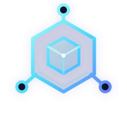
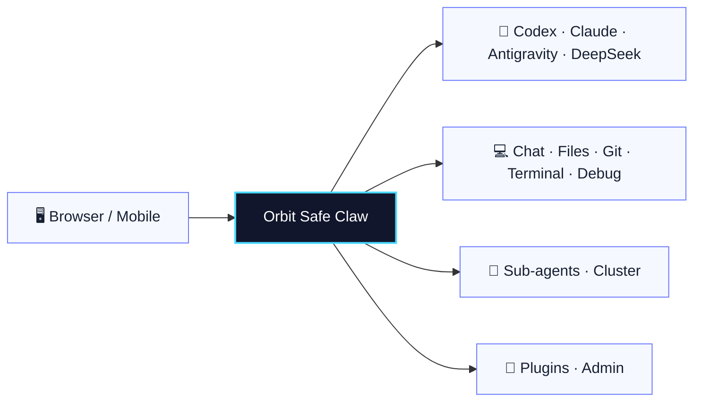

<p align="center">
  
</p>

<p align="center">
  <a href="README.md">简体中文</a> · <strong>English</strong>
</p>

<h1 align="center">Orbit Safe Claw</h1>

<p align="center">
  <strong>A self-hosted, multi-workspace AI development console for controlling Codex, Claude, Antigravity, and DeepSeek Harness from your browser.</strong>
</p>

<p align="center">
  Chat · Files · Git · Terminal · Debug · Plugins · Multi-agent Cluster
</p>

<p align="center">
  <a href="#quick-start">Quick Start</a> ·
  <a href="https://github.com/Augustusjk2008/telegram-cli-bot/releases/latest">Download</a> ·
  <a href="#feature-tour">Feature Tour</a> ·
  <a href="#advanced-configuration">Advanced Configuration</a> ·
  <a href="#license-branding-and-contributions">License</a> ·
  <a href="https://github.com/Augustusjk2008/telegram-cli-bot/issues">Report an Issue</a>
</p>

<p align="center">
  <a href="https://github.com/Augustusjk2008/telegram-cli-bot/releases/latest"></a>
  
  
  
  <a href="LICENSE"></a>
</p>

> [!NOTE]
> Orbit Safe Claw connects local AI CLIs, workspaces, and development tools to a remotely accessible web workbench, making multiple repositories, bots, sessions, and sub-agents easier to manage from one place. Model services and authentication come from the selected CLI configuration.

## At a Glance



<table>
  <tr>
    <td width="33%" valign="top"><strong>🤖 Multiple Bots and Sessions</strong><br><br>Each bot can use its own CLI, working directory, execution mode, and sessions. Agent scopes remain isolated, while web accounts authorized for the same bot share conversations.</td>
    <td width="33%" valign="top"><strong>🧰 Integrated Development Workbench</strong><br><br>Chat, edit files, inspect Git, use terminals, debug, and preview plugin content without constantly switching windows or context.</td>
    <td width="33%" valign="top"><strong>🧭 Sub-agents and Clusters</strong><br><br>Split review, implementation, and verification across sub-agents, routing rules, and cluster workflows, then collect results centrally.</td>
  </tr>
  <tr>
    <td valign="top"><strong>⚡ CLI Execution</strong><br><br>Codex, Claude, Antigravity, and DeepSeek Harness use CLI streams with tool calls, execution details, and context usage.</td>
    <td valign="top"><strong>🧩 Extensible Plugin Runtime</strong><br><br>Use <code>plugin.json</code> to add file viewers, settings pages, background processes, and full session-oriented views.</td>
    <td valign="top"><strong>🔒 Local-first and Self-managed</strong><br><br>Keep workspaces, sessions, configuration, and runtime data on your own devices, with user permissions, announcements, and update management included.</td>
  </tr>
</table>

## Quick Start

### Windows: Portable Edition Recommended

> [!TIP]
> The Windows portable package includes Python, Node.js, Git, and the built frontend. Extract it and start immediately. Install and configure Codex, Claude, Antigravity, or DeepSeek Harness separately when using those CLIs.

1. Open [GitHub Releases](https://github.com/Augustusjk2008/telegram-cli-bot/releases/latest).
2. Download `orbit-safe-claw-windows-x64-<version>.zip` and extract it to a writable directory.
3. Double-click `start.bat`, or run:

   ```powershell
   .\start.bat
   ```

4. Open the web address shown in the console, normally `http://127.0.0.1:8765`. Direct loopback access provides the local administrator identity, which can create registration codes in Admin Center. The login page uses a username and password; registration requires a code, and guest access is read-only.

For the conventional installer flow, download `orbit-safe-claw-windows-x64-installer-<version>.zip`, extract it, and run `install.bat`.

### Linux / macOS

| Platform | Installation |
|---|---|
| Linux x64 | Download `orbit-safe-claw-linux-x64-<version>.tar.gz`, extract it, then run `bash install.sh` |
| macOS | Download `orbit-safe-claw-macos-universal-<version>.tar.gz`, extract it, then run `bash install.sh` |

Extract into a dedicated directory:

```bash
mkdir orbit-safe-claw
tar -xzf orbit-safe-claw-<platform>-<version>.tar.gz -C orbit-safe-claw
cd orbit-safe-claw
bash install.sh
bash start.sh
```

Linux and macOS require Python 3.10+, Git, and Node.js 22.13+. Installers check these runtime versions.

The source launchers `start.bat`, `start.ps1`, and `start.sh` use the existing frontend assets and do not rebuild them during startup. After changing the frontend, run `npm run build` manually in `front`, then restart the service.


### Interactive and background service modes

The default start.bat / start.ps1 path keeps its tray and browser behavior, and python -m bot remains a supported direct launch. For unattended Windows operation, use the dependency-free Task Scheduler helpers:

    powershell -ExecutionPolicy Bypass -File .\scripts\install-service.ps1 -Repository $PWD -User "$env:USERDOMAIN\$env:USERNAME" -WhatIf
    powershell -ExecutionPolicy Bypass -File .\scripts\install-service.ps1 -Repository $PWD -User "$env:USERDOMAIN\$env:USERNAME"
    powershell -ExecutionPolicy Bypass -File .\scripts\service-status.ps1 -Repository $PWD
    powershell -ExecutionPolicy Bypass -File .\scripts\uninstall-service.ps1 -Repository $PWD -WhatIf
    powershell -ExecutionPolicy Bypass -File .\scripts\uninstall-service.ps1 -Repository $PWD

The task must run as the user who owns the Codex, Claude, Antigravity, DeepSeek Harness, and Telegram credentials; LocalSystem is not the default account. It calls start.ps1 -ServiceProcess -Mode service, ignores duplicate instances, and uses bounded restart attempts. Service mode defaults to no browser launch and no sleep inhibition. Explicit settings CLI_BRIDGE_SERVICE_MODE=1, WEB_AUTO_OPEN_BROWSER=true, or TCB_KEEP_AWAKE=true may override that behavior. Set TCB_SERVICE_LOG_ENABLED=true for a rotating service log; the default is runtime-data/logs/orbit-safe-claw-service.log, with TCB_SERVICE_LOG_PATH available for an external destination.

On Linux, the installer now renders and installs /etc/systemd/system/orbit-safe-claw.service from the current checkout path and account. It starts start.sh and the same scripts/update_runner.py; do not add a second watchdog. The installer writes the unit but does not start the service, and --check-only skips it. If you maintain the unit manually, change User, Group, WorkingDirectory, and ExecStart to match the target account and checkout path:

    sudo systemd-analyze verify /etc/systemd/system/orbit-safe-claw.service
    sudo systemctl daemon-reload
    sudo systemctl enable --now orbit-safe-claw.service

The unit waits for network-online.target, uses KillMode=control-group, and marks exit 78 as recovery-required so systemd does not restart in a loop. /api/health keeps ok as the process liveness result and ready/readiness as migration, Web, and frontend readiness; update identity fields remain backward-compatible, while token values require the temporary update probe header. Exit 0 is a manual stop, 75 requests a normal restart, 76 hands off a confirmed update, and 78 preserves recovery state for an operator. A crash or forced stop terminates the host's CLI, tunnel, terminal, and agent descendants; persisted chat history remains available after the next launch.

Service and update logs live outside program files, rotate by size, and redact authorization headers, tokens, API keys, passwords, and credentials. Fixed public forwarding must continue to preserve the /node/<node ID>/ prefix and WebSocket support.

<details>
<summary><strong>Install from a source snapshot</strong></summary>

Windows:

```powershell
$zip="$env:TEMP\orbit-safe-claw.zip"
Invoke-WebRequest "https://github.com/Augustusjk2008/telegram-cli-bot/archive/refs/heads/master.zip" -OutFile $zip
Expand-Archive $zip -DestinationPath . -Force
Set-Location .\telegram-cli-bot-master
.\install.bat
```

Linux/macOS:

```bash
curl -L https://github.com/Augustusjk2008/telegram-cli-bot/archive/refs/heads/master.tar.gz \
  | tar -xz
cd telegram-cli-bot-master
bash install.sh
```

</details>

## Feature Tour

### Multi-workspace Agent Control

- Bind the primary bot and managed bots to different repositories, CLIs, and working directories.
- Web sessions are isolated by bot, shared user domain, and agent; web accounts authorized for the same bot share the corresponding agent conversation.
- Codex (exec / app-server), Claude, Antigravity, and DeepSeek Harness CLI sessions retain streaming text, status events, traces, and completion events. Model lists and parameters are saved separately for each CLI type.
- Endless mode stores retryable errors and `Continue` events in one durable turn. Legacy grouped turns are consolidated in the database when history storage is opened, so reloading history returns the turn directly with its continue count.

### Scheduled Tasks

Administrators can schedule work for a Bot under Admin Center → 定时任务 (Scheduled tasks). When a schedule fires, the host opens a new conversation for the Bot's main agent and sends a fixed instruction. This works like sending `/new` and then a message from Weixin: the Bot's active conversation switches to the new one, and earlier history is kept.

- Triggers: a fixed time on every day or on selected weekdays, an interval in minutes (at least 5), or a single run. Times are evaluated in the chosen IANA timezone.
- When the Bot is busy, a run either waits for it to become idle (up to 15 minutes by default) or is skipped. A schedule never overlaps itself, and at most 2 scheduled runs execute at once.
- A fire missed while the host was down runs once if the host is back within the grace window (10 minutes by default); later than that, it is recorded as missed. No run starts while the host is draining for an update, restarting or migrating storage. Runs still active when the host stops are recorded as interrupted.
- Only an account with the `run_unsafe_cli` capability can let a schedule use unsafe CLI flags. The authorizing account is re-checked before every run, and the run falls back to safe flags if that capability was removed.
- Schedules and run history live in `scheduler/scheduler.sqlite3` under the app data directory. Replies are stored in the normal chat history, and Telegram/Weixin completion broadcasts behave as they do for any other turn.

### SSH remote workspaces

When creating an agent, select **Remote SSH**, choose Linux / POSIX or Windows, enter the SSH connection details, verify the first connection's host key fingerprint, and browse to a remote directory. After the remote device is replaced, SSH sign-in again shows the new fingerprint and can update the existing connection binding after explicit confirmation, keeping the same agent. Remote agents support chat, a file tree, UTF-8 text editing, file uploads, and independent SSH terminal tabs. The remote host needs SSH/SFTP; AI CLIs run on the Orbit host. DeepSeek Harness currently supports local workspaces only.

Local control directories default to `~/.tcb/orbit-safe-claw/remote-workspaces/` (respecting `TCB_DATA_DIR`) and contain generated `AGENTS.md` and `CLAUDE.md` instructions. Project files stay remote. Agent tools, file operations, and terminals reuse SSH connections; tools support command batches, bounded file ranges, and exact text edits.

Uploads from the file panel write to the remote workspace. Chat attachments are saved under `attachments/` in the local control directory for the local agent to process.

Password login offers an optional **Remember password** checkbox. After a successful connection, the password is encrypted under the application data `remote-ssh/` directory and bound to the connection and verified SSH host identity, allowing automatic reconnection after a service restart. **SSH sign in again** shows whether a password is saved: leave the password blank to reuse it, enter a new password to update it, or uncheck the option and connect successfully to remove the saved password. Saving is off by default; unsaved passwords and key passphrases stay in connection memory and are cleared when the connection closes. Passwords are never returned to the browser. Private key paths refer to the Orbit host. Text files are limited to 2 MiB. Remote workspaces currently omit language services, plugins, and debugging. Create another agent to use a different remote directory. File APIs stay within the selected root; commands and terminals use the SSH account's permissions, and local CLI tools retain their existing permission settings.

The remote Git panel supports Linux and Windows repositories when the selected directory is the repository root. It provides status, diffs including untracked files, branches, commit graphs and history, staging, commits, initialization, discard, branch creation/switch/reset, stash listing/apply/drop/pop, fetch/pull/merge/push, remote add/edit/remove, branch publishing, identity settings, commit-message generation, and smart commits. Stash creation is currently unavailable. Git operations run on the remote host and use its Git identity and credentials. Remote agents use the project's Git history.

Git must be available in the SSH account's non-interactive PATH. Missing Git, upstream configuration, or credentials produce diagnostics; Orbit does not install remote software. Fetch, pull, merge, push, and publish disable interactive credential prompts. Pull only fast-forwards; when both sides have new commits, Merge merges the upstream branch, and a conflicting merge is rolled back automatically with the conflicting files listed, leaving the repository as it was. After a write times out or loses its connection, refresh the state before retrying.

Windows targets need SSH/SFTP and `powershell.exe` (Windows PowerShell 5.1). Project tools such as Git, rg, and compilers must be on the remote account's PATH. Drive paths such as `C:\Projects\demo`, `C:/Projects/demo`, and `/C:/Projects/demo` are normalized to `/C:/Projects/demo`. File APIs reject UNC/device paths, alternate data streams, and junctions/symlinks. Windows 7 SP1 targets require compatible SSH/SFTP and PowerShell 5.1 installations; their terminal behavior and process cleanup still need verification on the actual machine. This compatibility scope applies to the remote target; the Orbit host requires a supported current runtime.

Windows text saves preserve UTF-8 BOM / CRLF, check for content conflicts, and replace files through a temporary file in the same directory while preserving ACLs. Failed replacements or disconnected writes may leave `.orbit-*.tmp` and `.bak` recovery files; inspect the target and recovery paths before retrying.

### Desktop Workbench

- **Chat**: CLI conversations, history recovery, execution details, and context status.
- **Files**: file tree, editor, previews, tabs, and language-service navigation. The editor has indentation guides, scope headers pinned to the top (sticky scroll), a breadcrumb of the symbols around the cursor, and a context menu. With language services enabled (`TCB_LSP_ENABLED=true`), C/C++ (clangd), Python (pyright) and JS/TS files also get semantic colouring, hover information, diagnostics, completion, an outline, find references (`Shift+F12`) and go to definition (`F12` / `Ctrl+click`). When the language server finds no definition, the editor lists text matches for the name and labels them as not semantic. clangd needs a `compile_commands.json` in the workspace root or a common build directory (or a root `.clangd` / `compile_flags.txt`) to resolve headers; without one the status bar reads "默认编译参数" (default compile flags).
- **Git** supports repository status, diffs, commit history, workspace operations, remote management, and GitHub linking. Open a side-by-side diff from Git or the file tree, drag across the code, then click **引用到聊天** (Quote to chat). The current bot’s draft gains the repository-relative path, line numbers for the selected sides, and the complete patch lines. Add your question and send it when ready.
- **Terminal** provides persistent tabs, each with its own shell and owner. In a local or SSH terminal, hold Ctrl and left-click `src/app.ts:42:7` to jump to line 42, column 7. The column defaults to 1. Relative paths resolve from the tab’s launch directory. After a manual `cd`, use an absolute path inside the workspace.
- **Debug**: debugging entry points for Python, C/C++, Godot, and generic DAP adapters.
- **Plugins**: extensible viewers for PDF, DOCX, PPTX, CSV, Vivado waveforms, and more.
- **Layout**: the header's layout menu offers Classic, Bottom panel, Four columns and Side stack presets; panes can be swapped by dragging, and the arrangement is saved per browser.
- **Tutorial**: click the logo in the upper-left corner of the desktop workbench to open the in-app usage tutorial, which explains each feature chapter by chapter with screenshots (content is in Chinese).

Completed answers have a read-aloud button using browser speech synthesis, with pause, resume, and stop controls and no API key setup. It reads the displayed answer, including a selected translation, skipping code blocks and execution details. Only one answer plays per page; switching conversations or entering live voice stops playback. Voices and language support depend on the browser and operating system, and some voices require a network connection. The button is disabled when speech synthesis is unsupported.

### GitHub Accounts and Remote Repositories

The Git panel's **Remotes** section lists, adds, edits, and removes remotes, and publishes the current branch (push and set upstream) to a chosen remote. Editing a URL updates both fetch and push. New remotes accept https, http, ssh, git, and file URLs or `user@host:path`; URLs must not contain passwords or tokens, and credentials stored in existing URLs are hidden.

Each Orbit account connects its own GitHub identity from **Remotes → Link GitHub repository** or **Settings → GitHub account**:

- **Browser sign-in**: set `GITHUB_OAUTH_CLIENT_ID` in `.env` or the Admin Center to the client ID of a GitHub OAuth App with *Enable Device Flow* checked (no client secret is needed). Orbit shows a code to confirm on github.com.
- **Personal access token**: classic tokens need `repo` and `read:org`; fine-grained tokens need Contents read/write on the target repositories, plus Administration write to create repositories.

Once connected, you can create an empty repository under your account or an organization (private by default, without a README so the local history is preserved) or pick an existing one, link it over HTTPS or SSH, and optionally publish the current branch right away.

Tokens are encrypted with an installation key under the application data `github/` directory and are never returned to the browser. In local workspaces, fetch, pull, merge, push, and publish against `https://github.com/` use the account's token through the Git child-process environment, never the command line, and disable other credential helpers and interactive prompts for that host; SSH URLs keep using local SSH keys. In SSH remote workspaces, GitHub API calls run on the Orbit host while Git sync keeps using the remote host's own credentials; Orbit never sends the token to the remote host. Disconnecting deletes only the stored token; revoke it in GitHub settings for full removal. GitHub API requests follow the system proxy environment (such as `HTTPS_PROXY`); Git sync uses Git's own proxy configuration.

### Local HTML Preview

The desktop workbench, chat file links, and mobile preview support interactive local HTML, including JavaScript, ES Modules, styles, images, fonts, relative JSON requests, project links, and hash routes. Use relative resource URLs; Vite builds need `base: "./"`. Each preview remains bound to its original resource directory. Remote SSH workspaces use a static HTML preview.

HTML files are limited to 1 MiB and individual resources to 16 MiB. The preview sandbox isolates the page from the console DOM, login credentials, and management APIs. Hidden directories, sensitive configuration, directory listings, server-side form submissions, external sites, development-server proxies, hot reload, persistent storage, and Service Workers are unavailable.

The toolbar supports refresh, return to the entry page, and retry. Resources are not cached. Preview tickets expire after 15 minutes and are revoked when the preview closes; retry after expiry or a workspace change to create a new ticket.

### Sub-agent and Cluster Collaboration

- On a local Bot, use the chat session selector to create a named chat or switch back to one. Accounts with access to that Bot share the chats. When you create a chat, choose an installed AI tool. For example, run Implementation with Codex and Review with Claude in the same workspace. The chat selector shows each chat’s tool and whether it is busy or idle. The Bot list names the running chats and cluster workers, including when several are active at once. A named chat keeps its selection and native CLI thread across reloads, restarts and changes to the Bot default. Chats marked **Bot default**, including the default session and chats created with only a title, follow the Bot’s current tool. Each turn takes its model and reasoning settings from the Bot configuration for that tool. Switching lets a turn finish in the background, and Stop affects the selected chat. Concurrent local text turns use the Bot’s configured parallel limit. The default session also supports cluster delegation, voice and the messaging gateways.
- Regular chats can select an explicit `agent_id` and use an isolated agent session; cluster templates prepare bot-level parallel slots and model tiers.
- CLI backends (including DeepSeek Harness) share cluster settings for 1–20 parallel slots, default timeout, write policy, and low/medium/high/professional model and reasoning tiers. Blank tier values inherit the main agent configuration. Model and reasoning choices follow the active CLI. The professional tier is reserved for special work and requires an explicit user request. Overrides apply only to child tasks, and queued tasks retain their configuration snapshot.
- Cluster tools cover dynamic team configuration, status checks, fresh sub-agent sessions, asynchronous task creation, targeted task cancellation, polling, and message waiting.
- Once bot-level clustering is enabled, the main agent delegates through the shared `tcb-cluster` tool surface. Codex (exec / app-server) and Claude inject stdio MCP; Antigravity configures workspace MCP; DeepSeek Harness loads MCP through `--patch` on cluster turns. The main agent can cancel one queued or running child task by `task_id` without stopping other tasks in the same run.
- All these backends support local clusters. Remote Antigravity cluster orchestration is unavailable, and DeepSeek Harness is limited to local CLI execution. A user-managed `tcb-cluster` entry in an Antigravity workspace is reported as a configuration conflict and must be resolved first.
- Ordinary turns in the same main conversation retain the current team and `run_id`; an actual team change returns a new ID. Tasks and progress are kept in memory, so running sub-agent tasks do not resume after a host restart.

### Single Telegram Gateway

One Telegram bot routes messages to enabled Web Bot aliases. Configure it in Admin Center's environment settings or the project `.env`:

```env
TELEGRAM_ENABLED=true
TELEGRAM_BOT_TOKEN=<token-from-BotFather>
TELEGRAM_ALLOWED_USER_IDS=123456789,987654321
TELEGRAM_BROADCAST_COMPLETIONS=false
```

Restart the application after saving these settings. The gateway accepts private text messages from the Telegram numeric user-ID allowlist, which is separate from Web `ALLOWED_USER_IDS`. An empty allowlist disables access. The bot token is treated as a secret and is not stored in the Telegram state database or logs.

By default, selecting a bot/agent, sending a message, or opening its panel binds the Telegram private chat to that conversation. Final Web replies for the same `alias + agent_id + conversation_id` are then delivered once to Telegram. Intermediate status, traces, and cluster child-task progress are omitted. Switching Web conversations does not move the binding; open the Telegram panel again or start a new conversation there to bind the new one.

Enable `TELEGRAM_BROADCAST_COMPLETIONS` to notify every allowlisted private-chat user of final Web or Telegram replies. The originating Telegram chat receives its direct reply once. Other recipients receive a completion notification; long replies begin with a preview that can be expanded with the button or by replying `/expand`. Users bound to that conversation also receive continue, new-conversation, and open-Web actions. Delivery retries and expansion read persisted replies without executing the agent task again.

Replies render Markdown headings, emphasis, strikethrough, lists, quotes, links, and code as Telegram rich text and split long messages into segments. Delivery progress and full replies are persisted so unsent segments can resume after a service restart.

| Command | Action |
|---|---|
| `/start`, `/help` | List agents and quick actions |
| `to dev analyze this issue` | Send to `dev`'s current shared conversation |
| `to dev /new` | Start a new conversation while retaining history |
| `/config dev` | Show execution mode, model, reasoning effort, and cluster state |
| `/config dev model <value>` | Set the active mode's model |
| `/config dev reasoning <value>` | Set reasoning effort |
| `/config dev cluster on\|off` | Toggle bot-level clustering |
| `/expand` | Expand the replied-to preview, or the latest preview when sent alone |
| `/host` | Show backend and public-entry (frp/tunnel) status; reconnect frp/tunnel or restart the backend after confirmation |

Use `/host` (or the Host key) when the public entry fails. Telegram long-polls `api.telegram.org` over outbound HTTPS and does not depend on frp or the tunnel. The panel shows version, PID, running work, public-entry state, Hub heartbeat, and the latest error. Reconnect matches Admin Center's tunnel restart. Restart asks for confirmation, interrupts running tasks, is refused during an update handoff, and notifies the requester once the backend is back. The gateway runs inside the host process, so it cannot recover a hung or exited host.

The keyboard also provides status, stop, configuration, host, and help actions. Model choices follow the active CLI configuration. Changes apply to the next turn; active tasks keep their initial configuration. Telegram and Web share `(Bot, shared user, agent)` sessions and history, and Telegram cancellation uses the Web task and cluster cancellation flow. Open-Web actions require `WEB_PUBLIC_URL` or fixed public forwarding with the `/node/<node-id>/` prefix preserved. Check the token, allowlist, application restart, competing `getUpdates` clients, public URL, and WebSocket proxy when troubleshooting.

### Personal Weixin iLink Gateway

Orbit Safe Claw can connect a personal WeChat account through Tencent's iLink Bot API. Enterprise WeChat uses a separate adapter. An administrator can start QR login from the Admin Center's Weixin panel. After confirmation, the Bot account ID, sensitive token, and API base URL are saved to the project `.env`; when the private-message allowlist is empty, the scanning user's iLink ID is added automatically. Restart the application after configuration changes:

```env
WEIXIN_ENABLED=true
WEIXIN_ACCOUNT_ID=<iLink Bot account ID from QR login>
WEIXIN_TOKEN=<iLink Bot token from QR login>
WEIXIN_BASE_URL=https://ilinkai.weixin.qq.com
WEIXIN_ALLOWED_USER_IDS=<comma-separated Weixin private user IDs>
```

The gateway uses HTTP long polling and does not require a public webhook. It accepts private text messages from allowlisted Weixin users and supports `/start`, `/help`, `to <alias> <text>`, `to <alias> /new`, `/config <alias>`, `/status`, and `/stop`. Send `/host` to view host status; send `/host restart`, then `/host restart confirm` within five minutes to confirm a backend restart. Weixin, Web, and Telegram share `(bot_id, shared_user_id, agent_id)` sessions and history; final replies follow conversation bindings, while trace events, status previews, and cluster child-task progress stay out of Weixin.

Ordinary WeChat groups, images, video, voice, files, cards, and message editing are outside the current scope. `WEIXIN_TOKEN` is excluded from API responses, frontend state, service logs, and the Weixin SQLite state database; the database stores the cursor, context tokens, conversation bindings, and recoverable delivery records. Telegram configuration, behavior, and its separate allowlist remain unchanged.

### Administration and Extensions

- Admin Center manages user permissions, invite codes, announcements, updates, and runtime status.
- Administrators publish notices to their own users from the Announcements tab in Admin Center. New deployments start with an empty list. The active TCB app data directory stores content and read state under `announcements/`. Project release notes are available in the Update Center.
- The release ships eight preset themes: Steel Core, Apollo Plan, Mint Citrus, K-On, Cyberpunk, Deepseek, Mist Paper, and Ink Brass. Each preset defines its colors, material (corner shape, glass, light and shadow) and illustrations. Every account, including administrators, can only choose and apply these presets; editing, importing, deleting, and uploading theme resources are disabled. Signed-in accounts save their selected theme independently, while the login page keeps its preview choice in the current browser.
- A theme `appearance` may include an `illustrations` object for workbench, chat, topbar, and management decoration. For example: `{"setId":"forest-grove","opacity":0.12,"surfaces":{"workbench":true,"chat":true,"topbar":true,"management":false}}`. `setId` uses the release package's built-in `none`, `forest-grove`, `tidal-grove`, `desert-dusk`, `alpine-fog`, `moonlit-garden`, `armor-core-hud`, `apollo-plan`, `mint-citrus`, `cyberpunk-2077`, `deepseek-big-fish`, or `k-on-light-music` resources, and opacity is limited to `0` through `0.25`.
- Preset illustration resources are shipped in the release package through the illustration catalog and frontend assets, and remain part of each preset appearance when themes are exported.
- Codex CLI usage can be aggregated by local calendar day, provider, and model; Claude subscription quota is tracked separately.
- The Cost page totals per-turn Codex and Claude cost over a chosen date range, broken down by user, Bot, or model.
- Cloudflare quick tunnels and fixed public forwarding support controlled mobile access.

## Support Matrix

### Release Packages

| Package | Best for | Runtime |
|---|---|---|
| Windows portable | Fast setup and portable/offline use | Bundles Python, Node.js, Git, and frontend assets |
| Windows installer | Conventional local installation | Installer checks and prepares dependencies |
| Linux x64 | Self-hosting on Linux | Uses system Python, Node.js, and Git |
| macOS universal | macOS source package | Uses system Python, Node.js, and Git |

### Execution Modes

| Mode | Primary target | Transport and presentation |
|---|---|---|
| `cli` | Codex exec / app-server, Claude, Antigravity, DeepSeek Harness | Legacy SSE: text, status, trace, and completion events |
| Cluster | All CLI backends above; per-bot configuration and per-conversation teams | Dynamic team setup, asynchronous delegation, polling, result messages, and model tiers |

## Security Boundary

> [!WARNING]
> Orbit Safe Claw can read and write workspace files, execute terminal commands, and operate Git. Never expose an unprotected instance directly to the public internet.

- Use account login and limit administrator privileges.
- Put public access behind a trusted reverse proxy, firewall, and TLS. The reverse proxy must support WebSocket.
- Never commit `.env`, a real `managed_bots.json`, or runtime data under `~/.tcb/`.
- Keep `TCB_DATA_DIR` outside the workspace to separate application data from project files.
- Closing a terminal tab terminates its shell. Old background terminal sessions do not survive a web-service restart.

## Basic Configuration

After the first installation, verify at least:

```env
CLI_TYPE=codex
CLI_PATH=codex
WORKING_DIR=C:\Users\YourName\project
WEB_ENABLED=true
WEB_HOST=0.0.0.0
WEB_PORT=8765
```

Web login credentials are set during account registration.

CLI types and default commands are listed below. `CLI_PATH` / `cli_path` also accepts the executable's full path.

| `CLI_TYPE` / `cli_type` | Default command | Execution |
|---|---|---|
| `codex` | `codex` | `codex exec` with JSON events |
| `codex_server` | `codex` | Persistent `codex app-server --stdio`, under `execution_mode=cli` |
| `claude` | `claude` | Claude CLI |
| `antigravity` | `agy` | Antigravity print / stream-json |
| `deepseek` | `dsh` | DeepSeek Harness headless / JSONL |

DeepSeek Harness supports provider, model, and reasoning-effort selection in chat and local clusters. Orbit reads the dsh profile catalog, filters models and reasoning levels by the selected provider, and keeps a custom model input when a provider has no enumerable models. Selections are stored per Bot and applied through a per-invocation patch while preserving global Harness configuration. Switching providers clears the current Web user's DeepSeek session binding; model changes within one provider keep the session. Native execution and remote workspaces are unavailable. Commit-message generation can independently use the local CLI or the LLM API; the CLI option supports Codex, codex server, or Claude, while Antigravity and DeepSeek Harness remain unsupported for this feature. Chat translation can likewise switch between the LLM API and a local CLI; its CLI type, path, and parameters are configured on the Admin Center translation page, independently of each Bot's CLI, and all five CLI types are available.

Desktop execution temporarily bridges the Desktop profile's `agent-default-model`, `credentials`, `llm-pi-ai`, and `llm-deepseek` entries into headless execution. Catalog and diagnostic surfaces expose provider/model metadata only; credential contents stay out of API responses, stdout, stderr, and history. Catalog failures keep the current selection and static model candidates available.

`cli_params.codex_server` and `cli_params.codex` keep separate settings with the same parameter definitions and defaults. Switching backends preserves both. Global extra arguments also use separate keys, for example `CLI_GLOBAL_EXTRA_ARGS={"codex_server":["-c","model_reasoning_effort=high"]}`. Both backends share Codex history, model-parameter, and cost semantics.

Application data defaults to `~/.tcb/orbit-safe-claw`; `TCB_DATA_DIR` overrides that directory. Plugins and chat history use their own directories under `~/.tcb`. After a storage migration, the locator at `~/.tcb/storage.json` determines the active roots, and a conflicting `TCB_DATA_DIR` prevents startup for source installations. Windows portable packages use a separate `.tcb` storage root inside the package, so a host user's migrated locator is not imported. Portable packages place application data under the package's `data/` directory; after a portable migration, the package locator determines the application data directory.

<details>
<summary><strong>Manage multiple bots</strong></summary>

Create a local `managed_bots.json` based on `managed_bots.example.json`:

```json
{
  "bots": [
    {
      "alias": "repo2",
      "cli_type": "codex",
      "cli_path": "codex",
      "working_dir": "C:/work/repo2",
      "enabled": true
    }
  ]
}
```

</details>

## Advanced Configuration

### Model Cost Estimates

Context details show a cost calculated from `bot/data/model_prices.csv`. Prices are per million tokens, with currency in the `currency` column: CNY (RMB) for DeepSeek and USD for the other default models. Input, cache reads, cache writes, and output are priced separately; reasoning is not charged again on top of output. Claude's optional one-hour cache-write rate is used when that duration is reported.

Models match the CSV's `model` column exactly. Add aliases or dated model IDs as rows, or set `MODEL_PRICES_FILE` in `.env` to use another CSV. Changes apply to subsequent calculations; saved replies retain their cost snapshots. Missing prices, invalid tables, or incomplete usage leave the estimate unavailable.

Each Codex exec turn is priced from its own tokens: the increase in the cumulative token counter in the local Codex session log between the start and end of the turn, at that turn's model price. A turn you stop is charged only for model responses that completed (it has no cost if stopped before the first one) and does not affect the next turn, and a mid-session model change prices each turn at its own model. When the session log cannot be read (for example in a remote workspace), the older method applies: the session's cumulative `turn.completed` usage is priced, and message details show the increase over the session's last cumulative amount, skipping turns without a cost and excluding per-turn amounts shown in between; a lower amount is shown as is. Codex app-server already prices each turn's own usage. Claude uses the cost Claude Code itself reports in USD instead of the price table: the amounts of every `result` event in one CLI invocation are summed, so continuations after background-task notifications, subagents and every model used are included. Older Claude Code versions without that amount fall back to pricing the terminal usage from the table, and a run interrupted before any `result` keeps a table-based partial estimate. DeepSeek Harness prices deduplicated step usage at the end of each turn, with separate uncached-input and cache-read buckets. Both explicit model choices and inherited Harness defaults are supported; interrupted or failed runs retain priceable reported usage as partial estimates. Cluster child costs stay with their individual replies.

DeepSeek uses [official peak CNY prices](https://api-docs.deepseek.com/zh-cn/quick_start/pricing/) checked on 2026-10-22. Per million tokens, uncached input / cache reads / output cost 2 / 0.04 / 8 yuan for `deepseek-flash` and 9 / 0.30 / 27 yuan for `deepseek-v4-pro`, with no separate cache-write charge. Official off-peak prices are half these rates; this fixed-rate CSV estimate does not switch by time of day. Other default prices were checked on 2026-09-05, with references in `source_url`. Subscription charges and additional long-context, speed, region, or tool pricing rules are not applied automatically; adjust the table for your provider's rates.

<details>
<summary><strong>Fixed public address with an frp reverse proxy</strong></summary>

A server with a fixed public IP can forward traffic to machines behind NAT through frp. Every machine must have a unique node path, and the complete `/node/<node-id>/` prefix must be preserved:

```text
http://<public-ip>:18088/node/<node-id>/
```

Local `.env`:

```env
TCB_NODE_ID=my-laptop
WEB_BASE_PATH=/node/my-laptop
WEB_PUBLIC_URL=http://<public-ip>:18088/node/my-laptop
WEB_FIXED_PUBLIC_FORWARD_ENABLED=true
WEB_FIXED_PUBLIC_FORWARD_URL=http://<public-ip>:18088/node/my-laptop
TCB_HUB_FRPS_PORT=7000
TCB_HUB_FRPS_TOKEN=<frps-token>
TCB_HUB_NODE_TOKEN=<random-node-token>
TCB_HUB_FRPC_PATH=frpc
TCB_HUB_FRPC_AUTOSTART=true
```

`frps.toml` on the fixed-IP server:

```toml
bindPort = 7000
vhostHTTPPort = 18765
auth.token = "<frps-token>"
```

Nginx must preserve the node path and support WebSocket:

```nginx
map $http_upgrade $connection_upgrade {
  default upgrade;
  '' close;
}

server {
  listen 18088;

  location /node/my-laptop/ {
    proxy_pass http://127.0.0.1:18765;
    proxy_http_version 1.1;
    proxy_set_header Host $host;
    proxy_set_header X-Real-IP $remote_addr;
    proxy_set_header X-Forwarded-For $proxy_add_x_forwarded_for;
    proxy_set_header X-Forwarded-Proto $scheme;
    proxy_set_header Upgrade $http_upgrade;
    proxy_set_header Connection $connection_upgrade;
  }
}
```

Allow inbound traffic on `18088` and `7000`. `WEB_BASE_PATH` must match the reverse-proxy path exactly. Rebuild the frontend and restart the web service after changing the path. If a Web-managed frpc fails to start or exits unexpectedly, Orbit retries three times with a five-second delay; if it still cannot recover, it retries every ten minutes until it recovers or fixed forwarding is stopped manually.

</details>

<details>
<summary><strong>Codex CLI usage statistics</strong></summary>

Collection can be enabled or disabled immediately on the Admin Center Usage page. It is disabled by default and only measures regular Codex CLI processes launched by Orbit after collection is enabled. It does not backfill history or include Claude, inline completion, or manually launched terminal processes.

Usage is aggregated by date, provider, and model. Data is stored in `~/.tcb/orbit-safe-claw/codex-usage/usage.sqlite3` by default and does not store per-turn prompts, authentication headers, or API keys.

Claude quota shares the Usage page with Codex, with an in-page switcher between the two; Claude has its own collection switch, also disabled by default, and shares the same database with separate data. It records the last `rate_limit_event` from each stream-json turn of a regular Claude CLI process: the 5-hour, weekly, and overage-included weekly windows, with the weekly trend shown. The plan type comes from `claude auth status --json`; only the login method, API provider, and subscription type are kept. Turns without stream-json output or API-key or Bedrock/Vertex logins are not recorded.

Machines signed in to the same account can merge their quota curves. **Export samples** on the Usage page downloads the Codex and Claude samples stored on this host within the currently queried date range (server-local days, matching the chart) as one JSON file; **Import samples** on another host merges that file into the same curves. A sample is identified by its quota window and millisecond timestamp, so importing a file twice, or receiving a host's own samples back through another host, adds nothing. Imported samples keep the label of the machine that took them (`TCB_NODE_ID`, otherwise the hostname), which the chart tooltip shows; **Remove imported** deletes them without touching samples collected locally. Quota percentages from different accounts cannot be merged, so import only files from hosts using the same account.

</details>

<details>
<summary><strong>Codex and Claude cost statistics</strong></summary>

The Cost page sits to the right of Usage in the Admin Center, with separate Codex and Claude views and a separate statistics switch for each, both disabled by default. Once enabled, Orbit records one cost estimate per turn when the turn ends (the same figure shown in message details); history is not backfilled. While disabled, nothing is read from or written to the database, and existing records remain queryable. Interrupted or failed turns are recorded as partial estimates from the usage reported so far.

- Claude uses the cost Claude Code reports itself, including continuations after background tasks, subagents, and every model used.
- Codex is priced from the price table on each turn's own tokens (see Model Cost Estimates) and recorded as that turn's amount. Only when the Codex session log cannot be read is the turn's amount derived from the session's running total minus the session's previous running total.

Cluster sub-agent costs are added to their Bot and are not shown separately. They are attributed to the account that queued them, as are the main agent's automatic wake-up turns that process their results.

Choose a date range (today, last 7/30/90 days, all, or custom dates) and a granularity (auto, hour, day, week, month), then view a stacked trend, a ranking, and the most expensive turns by user, Bot, or model, compared with the previous period of the same length; the chart can switch to a table. Different currencies are shown separately and never converted. Buckets follow server-local time.

Data is stored in `~/.tcb/orbit-safe-claw/cost-stats/cost.sqlite3` by default and holds only amounts, models, Bots, acting accounts, and session identifiers, never prompts or replies. Each query is aggregated once in SQLite and briefly cached in memory until a new record is written.

</details>

<details>
<summary><strong>Choose the web terminal shell</strong></summary>

```env
WEB_TERMINAL_SHELL_PATH=/usr/bin/zsh
```

Windows example:

```env
WEB_TERMINAL_SHELL_PATH=C:\Program Files\PowerShell\7\pwsh.exe
```

This setting only controls the shell inside the web xterm. It does not launch an external GUI terminal.

</details>

## Updates

Admin Center provides “Check → Prepare → Apply”. With automatic checks enabled, the host checks at startup and every 6 hours; a newer release is only prepared, and an administrator explicitly confirms application. A cancelled release, or one that failed after its download completed, is not prepared again automatically; only interrupted downloads are retried. Cancelling stops running dependency installs and frontend builds; retrying reuses the previous partial or complete download. Jobs survive page refreshes, disconnects and ordinary restarts, and are isolated by installation directory even when installations share an application-data root.

The official Windows source launchers (`start.bat` / `start.ps1`), Windows portable launcher and Linux/macOS `start.sh` hand control to an independent executor. Exit `75` requests an ordinary restart; exit `76` applies a confirmed job. Direct `python -m bot` and unknown supervisors support checking and preparation; Admin Center shows the official command for that installation.

Preparation checks versions, platform, package kind, SHA-256, the file manifest and local modifications, then prepares dependencies and frontend assets in separate directories. Portable packages contain the runtime. Offline source upgrades require compatible installed dependencies or local pip resources. Local frontend builds require Node.js 22.13+ and use `npm ci`; incompatible deployment paths with rebuilding disabled prevent application.

Wait for agents, cluster tasks and storage migration to finish before applying. The service disconnects temporarily, and only files whose content changed are replaced. Success requires a new instance with the expected version, job identity, local health response and complete frontend resources; health confirmation waits up to 180 seconds by default (`TCB_UPDATE_HEALTH_TIMEOUT_SECONDS`, 30–1800). Failure restores the old program and environment and verifies them again. After a successful update, open pages prompt a reload to load the new interface. A `recovery_required` result includes a recovery command; retain the job directory and logs (Admin Center shows the `preparation.log` and `runner.log` paths), resolve the reported conflicts, and run that command.

Updates protect `.env`, real Bot configuration, storage-locator data, plugins, history, and attachments. Update manifests manage program files only. Program recovery preserves user data. Unverified or incompatible data migrations prevent automatic application before shutdown.

For the first upgrade from a version without this executor, extract the full new release outside the installation and use its `scripts/update_bootstrap.py`. Verify the release SHA-256 and run with the new portable Python or an available source-installation Python:

```powershell
powershell -ExecutionPolicy Bypass -File C:/upgrade/new/scripts/update_bootstrap.ps1 -RepoRoot C:/OrbitSafeClaw -WorkDir C:/upgrade/session -Package C:/upgrade/new-release.zip -Sha256 <NEW_SHA256> -Python C:/upgrade/new/runtime/python/python.exe -HealthUrl http://127.0.0.1:8765/api/health
```

For a source installation, set `-Python` to its available Python executable. Linux/macOS run `python scripts/update_bootstrap.py` from the extracted release with the equivalent `--repo-root`, `--work-dir`, `--package`, `--sha256`, and `--health-url` options. Use the actual local port and path prefix for the health URL. Installations without Git or a previous file manifest also require `--baseline-package <ORIGINAL_RELEASE> --baseline-sha256 <ORIGINAL_SHA256>` to establish program-file ownership; modified files remain conflicts. After preparation, exit the old service yourself, then run the printed apply command containing `--resume --apply --host-stopped`. The tool also prints an independent recovery command. Linux/macOS use the same options and their `.tar.gz` release. Retain the bootstrap workspace until application or recovery has been verified.

If an old `.update-apply-*` transaction is detected, exit the old host, run `python -m bot.updater recover-legacy --repo-root <OLD_INSTALLATION> --host-stopped` from the extracted new release, then prepare again. Missing backups or uncertain target ownership preserve the recovery materials and return `recovery_required`.

The PowerShell bootstrap uses `-BaselinePackage` and `-BaselineSha256` for the baseline. Each installation permits one host at a time; after a storage move, the new host reports the current task-state location to its launcher. Update job directories (`updates/<installation>/jobs`, containing dependency environments, staged files and recovery backups) are installation program material; a storage migration leaves them in the original data directory, so do not delete them manually. When a new preparation starts, or after an update succeeds or rolls back, finished job directories older than 24 hours are removed automatically if no update state, running interpreter or executor references them and their transaction backups were conclusively released; nothing is pruned during handoff, application or recovery.

The generated `.env` includes:

```env
APP_UPDATE_REPOSITORY=https://github.com/Augustusjk2008/telegram-cli-bot
```

In Admin Center → Environment → Updates, set the update source address to a full HTTP(S) latest-release API URL, such as `https://updates.example.com/releases/latest`. Requests use that URL directly, including custom domains and proxy addresses. The endpoint must return GitHub Releases-compatible JSON with `tag_name` and `assets` (each with `name` and an absolute `browser_download_url`); `body` and `html_url` are optional. The package and its matching `.sha256` file are downloaded from the returned asset URLs.

Full GitHub repository URLs (including `.git`, `/releases` and `/releases/latest` suffixes) resolve to the latest-release API. Existing `owner/repo` values remain supported. Restart the backend after saving the configuration.

## Project Layout

```text
.
├─ bot/                    # Python backend, Web API, bots, plugins
├─ front/                  # React/Vite workbench frontend
├─ examples/plugins/       # Example plugins and file viewers
├─ tests/                  # Backend and integration tests
├─ scripts/                # Installation, build, and helper scripts
├─ deploy/                 # Deployment files
├─ install.*               # Installation entry points
├─ start.*                 # Startup entry points
├─ managed_bots.example.json
├─ LICENSE / NOTICE        # Apache-2.0 and copyright notice
├─ THIRD_PARTY_NOTICES.md  # Third-party license inventory
├─ TRADEMARKS.md           # Project name and logo policy
├─ CONTRIBUTING.md         # Contribution guide and licensing terms
└─ AGENTS.md               # Coding-agent conventions
```

Local runtime files include `.env`, `managed_bots.json`, `front/dist/`, and `~/.tcb/orbit-safe-claw`. Do not commit real configuration or runtime data.

## Development and Verification

```bash
# Backend
python -m bot
python -m pytest tests -q

# Frontend
cd front
npm run test:gate
npm run lint
npm run build
```

Windows is the primary platform, with Linux and macOS installation and startup scripts maintained alongside it. Layout changes should include browser-level checks. Release-package changes should run the backend test suite, frontend gate, lint, and production build.

Browser tests reuse an application already started by the user. Windows defaults to installed Google Chrome. From `front/`, run:

```powershell
$env:PLAYWRIGHT_BASE_URL = "http://127.0.0.1:8765"
npm run e2e:smoke
```

The in-app tutorial's screenshots and hotspot data are regenerated from mock data with `npm run tutorial:shots` (run from `front/`); it does not start any server.

Coding agents must not start development, preview, or temporary HTTP servers. Documentation-only changes need source, command, and link checks; select existing tests according to the affected behavior and avoid new tests for ordinary copy.

## License, Branding, and Contributions

Original project code, documentation, and logo artwork are licensed under the [Apache License 2.0](LICENSE); see [NOTICE](NOTICE) for copyright attribution. The license permits commercial use, modification, and redistribution and includes an express patent grant, subject to its notice, change-marking, and other conditions.

Third-party components remain subject to their own licenses; see [THIRD_PARTY_NOTICES.md](THIRD_PARTY_NOTICES.md). Production builds generate `front/dist/THIRD_PARTY_LICENSES.txt` from the frontend modules actually emitted and include it in release archives. The `Orbit Safe Claw` name and the logos in `front/public/assets/app-logo*.svg` are project marks. The copyright license for the logo files does not confer trademark rights, endorsement, or official status, and Apache License 2.0 does not grant permission to brand a fork or derivative product with them. See [TRADEMARKS.md](TRADEMARKS.md) for permitted uses and permission requests.

Read [CONTRIBUTING.md](CONTRIBUTING.md) before submitting changes. Unless explicitly stated otherwise in writing, contributions intentionally submitted for inclusion are provided under Apache License 2.0.

## Getting Help

- Downloads and versions: [GitHub Releases](https://github.com/Augustusjk2008/telegram-cli-bot/releases)
- Bugs and feature requests: [GitHub Issues](https://github.com/Augustusjk2008/telegram-cli-bot/issues)
- Configuration examples: `.env.example` and `managed_bots.example.json`
- Testing policy: [CONTRIBUTING.md](CONTRIBUTING.md)

If Orbit Safe Claw helps you, consider leaving a Star or sharing your use case through an Issue.
