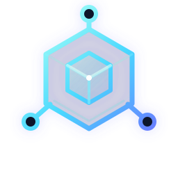
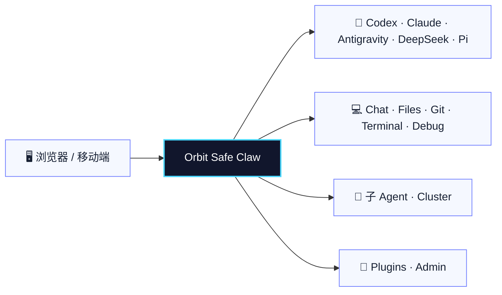

<p align="center">
  
</p>

<p align="center">
  <strong>简体中文</strong> · <a href="README.en.md">English</a>
</p>

<h1 align="center">Orbit Safe Claw</h1>

<p align="center">
  <strong>在浏览器中统一操控 Codex、Claude、Antigravity、DeepSeek Harness 与 Pi 的多工作区 AI 开发控制台。</strong>
</p>

<p align="center">
  Chat · Files · Git · Terminal · Debug · Plugins · Multi-agent Cluster
</p>

<p align="center">
  <a href="#快速开始">快速开始</a> ·
  <a href="https://github.com/Augustusjk2008/telegram-cli-bot/releases/latest">下载最新版</a> ·
  <a href="#功能导览">功能导览</a> ·
  <a href="#高级配置">高级配置</a> ·
  <a href="#开源协议品牌与贡献">开源协议</a> ·
  <a href="https://github.com/Augustusjk2008/telegram-cli-bot/issues">反馈问题</a>
</p>

<p align="center">
  <a href="https://github.com/Augustusjk2008/telegram-cli-bot/releases/latest"></a>
  
  
  
  <a href="LICENSE"></a>
</p>

> [!NOTE]
> Orbit Safe Claw 把本机 AI CLI、工作区和开发工具接入一个可远程访问的 Web 工作台，让多个仓库、Bot、会话和子 Agent 统一管理。模型服务及其认证由所选 CLI 或 Pi 配置提供。

## 一眼看懂



<table>
  <tr>
    <td width="33%" valign="top"><strong>🤖 多 Bot 与多会话</strong><br><br>每个 Bot 绑定自己的 CLI、工作目录、执行模式和会话；Agent 作用域相互隔离，获准访问同一 Bot 的 Web 账号共享对话。</td>
    <td width="33%" valign="top"><strong>🧰 一体化开发工作台</strong><br><br>在同一页面完成聊天、文件编辑、Git、终端、调试和插件预览，减少窗口与上下文切换。</td>
    <td width="33%" valign="top"><strong>🧭 子 Agent 与集群</strong><br><br>通过子 Agent、路由和集群模式拆分审查、实现与验证任务，并统一回收结果。</td>
  </tr>
  <tr>
    <td valign="top"><strong>⚡ CLI 与原生执行</strong><br><br>Codex、Claude、Antigravity 和 DeepSeek Harness 使用 CLI 流；Pi 原生 Agent 使用 AG-UI，保留工具调用、权限请求和上下文用量。</td>
    <td valign="top"><strong>🧩 可扩展插件运行时</strong><br><br>通过 <code>plugin.json</code> 扩展文件视图、配置页和后台进程，支持重型 session 视图。</td>
    <td valign="top"><strong>🔒 本地优先、自主管理</strong><br><br>工作区、会话、配置和运行数据保留在自己的设备上，并提供用户权限、公告和更新管理。</td>
  </tr>
</table>

## 快速开始

### Windows：推荐使用绿色版

> [!TIP]
> Windows 绿色版内置 Python、Node.js、Git、Pi CLI、Pi 扩展和前端产物；解压即可启动。使用 Codex、Claude、Antigravity 或 DeepSeek Harness 时，请在本机另行安装并配置对应 CLI。

1. 打开 [GitHub Releases](https://github.com/Augustusjk2008/telegram-cli-bot/releases/latest)。
2. 下载 `orbit-safe-claw-windows-x64-<version>.zip` 并解压到可写目录。
3. 双击 `start.bat`，或在终端执行：

   ```powershell
   .\start.bat
   ```

4. 按控制台输出打开 Web 地址，默认为 `http://127.0.0.1:8765`。直接从本机回环地址访问可使用本地管理员身份，在 Admin Center 创建注册码或指定唯一的管理员账号。登录页使用用户名和密码，注册需要注册码，也提供 guest 只读入口。

需要传统安装流程时，下载 `orbit-safe-claw-windows-x64-installer-<version>.zip`，解压后运行 `install.bat`。安装过程中可传入 `-AdminUsername <用户名>`，安装器会交互式创建管理员账号；非交互安装同时传入 `-AdminPassword <密码>`。

### Linux / macOS

| 平台 | 安装方式 |
|---|---|
| Linux x64 | 下载 `orbit-safe-claw-linux-x64-<version>.tar.gz`，解压后运行 `bash install.sh` |
| macOS | 下载 `orbit-safe-claw-macos-universal-<version>.tar.gz`，解压后运行 `bash install.sh` |

推荐解压到独立目录：

```bash
mkdir orbit-safe-claw
tar -xzf orbit-safe-claw-<platform>-<version>.tar.gz -C orbit-safe-claw
cd orbit-safe-claw
bash install.sh
bash start.sh
```

安装时创建管理员账号：

```bash
bash install.sh --admin-username admin
```

安装器会交互式读取密码。非交互安装可同时传入 `--admin-password <密码>`，或设置 `TCB_ADMIN_USERNAME` / `TCB_ADMIN_PASSWORD`。

Linux/macOS 需要 Python 3.10+、Git 和 Node.js 22.13+；Pi 原生 Agent 还需要 bash。安装器会检查这些运行时版本。

源码版 `start.bat`、`start.ps1` 和 `start.sh` 启动时直接使用现有的前端产物，不会自动重建前端。修改前端后请在 `front` 目录手动运行 `npm run build`，再重启服务。


### 交互启动与后台服务

默认 start.bat / start.ps1 保留托盘和浏览器行为；python -m bot 仍可直接运行。需要无人值守运行时，Windows 使用任务计划程序：

    powershell -ExecutionPolicy Bypass -File .\scripts\install-service.ps1 -Repository $PWD -User "$env:USERDOMAIN\$env:USERNAME" -WhatIf
    powershell -ExecutionPolicy Bypass -File .\scripts\install-service.ps1 -Repository $PWD -User "$env:USERDOMAIN\$env:USERNAME"
    powershell -ExecutionPolicy Bypass -File .\scripts\service-status.ps1 -Repository $PWD
    powershell -ExecutionPolicy Bypass -File .\scripts\uninstall-service.ps1 -Repository $PWD -WhatIf
    powershell -ExecutionPolicy Bypass -File .\scripts\uninstall-service.ps1 -Repository $PWD

任务以拥有 Codex、Claude、Pi、DeepSeek Harness 和 Telegram 凭据的用户运行；LocalSystem 不是默认账户。任务调用 start.ps1 -ServiceProcess -Mode service，同一任务名使用 IgnoreNew，并在崩溃后有限次数重试。服务模式默认不会打开浏览器，也不会阻止系统睡眠，除非显式设置 CLI_BRIDGE_SERVICE_MODE=1、WEB_AUTO_OPEN_BROWSER=true 或 TCB_KEEP_AWAKE=true。TCB_SERVICE_LOG_ENABLED=true 可启用轮转服务日志；默认位置是运行数据目录 logs/orbit-safe-claw-service.log，也可用 TCB_SERVICE_LOG_PATH 指定外部路径。

Linux 安装阶段会根据当前 checkout 路径和执行账户，自动生成并安装 `/etc/systemd/system/orbit-safe-claw.service`；它通过 `start.sh` 和同一个 `scripts/update_runner.py` 运行，不要另起 watchdog。安装脚本只写入 unit，不会自动启动服务；`--check-only` 不会写入。若需要手动维护 unit，再把 `User`、`Group`、`WorkingDirectory` 和 `ExecStart` 改为目标用户及 checkout 路径：

    sudo systemd-analyze verify /etc/systemd/system/orbit-safe-claw.service
    sudo systemctl daemon-reload
    sudo systemctl enable --now orbit-safe-claw.service

服务入口等待 network-online.target，使用 KillMode=control-group，并把退出 78 标记为需要恢复，避免自动重启循环。/api/health 的 ok 表示进程存活，ready 和 readiness 表示迁移、Web 和前端资源均可用；健康响应继续保留更新任务身份字段，更新探针必须提供临时令牌才会看到令牌值。退出码 0 是人工停止，75 请求普通重启，76 交接已确认的更新，78 保留恢复现场并等待人工处理。崩溃或强制停止时，内存中的 CLI、隧道、终端和 Agent 进程会被宿主进程树一起清理；已持久化的聊天历史仍可在下次启动后使用。

日志和更新任务目录都位于运行数据或安装控制目录之外，并按大小轮转；服务日志过滤授权头、Token、API key、密码和凭据。固定公网转发仍必须保留 /node/<节点 ID>/ 前缀并支持 WebSocket。

<details>
<summary><strong>从源码快照安装</strong></summary>

Windows：

```powershell
$zip="$env:TEMP\orbit-safe-claw.zip"
Invoke-WebRequest "https://github.com/Augustusjk2008/telegram-cli-bot/archive/refs/heads/master.zip" -OutFile $zip
Expand-Archive $zip -DestinationPath . -Force
Set-Location .\telegram-cli-bot-master
.\install.bat
```

Linux/macOS：

```bash
curl -L https://github.com/Augustusjk2008/telegram-cli-bot/archive/refs/heads/master.tar.gz \
  | tar -xz
cd telegram-cli-bot-master
bash install.sh
```

</details>

## 功能导览

### 多工作区 Agent 控制

- 主 Bot 与托管 Bot 可绑定不同仓库、CLI 和工作目录。
- Web session 按 Bot、共享用户域和 Agent 隔离；获准访问同一 Bot 的 Web 账号共享对应 Agent 对话。
- Codex（exec / app-server）、Claude、Antigravity 和 DeepSeek Harness 的 CLI 会话保留流式正文、状态、trace 和完成态；模型列表及参数按 CLI 类型独立保存。
- Pi 原生 Agent 保留 session、工具调用、权限请求、上下文用量和过程详情。

### 无尽模式

在可继续的回答操作中选择「无尽模式」后，Orbit 会在可重试的未完成或错误结果后按配置间隔自动发送 `Continue`。遇到不可重试错误或用户终止后，自动续接会结束。

每次续接的错误和 `Continue` 事件都会写入同一个持久化 turn；重新加载历史时直接返回这条回答并保留继续次数，旧数据中的分组 turn 也会在数据库中整理。运行期间会显示执行状态和当前次数，也可以使用「终止无尽模式」停止任务。默认续接间隔为 120 秒，可通过 `ENDLESS_CONTINUE_DELAY_SECONDS`（单位：秒）调整。

### SSH 远程工作区

创建智能体时选择「远程 SSH」，在连接表单选择远程系统（Linux / POSIX 或 Windows），填写 SSH 连接信息，核对首次连接的主机密钥指纹，再浏览并选择远程目录。支持聊天、文件树、UTF-8 文本读写、文件上传和独立的 SSH 终端标签；远程主机需要 SSH/SFTP，AI CLI 或 Pi 在 Orbit 宿主机运行。DeepSeek Harness 当前只支持本地工作区。

Agent 仍在运行 Orbit 的电脑上执行。本地控制目录默认位于 `~/.tcb/orbit-safe-claw/remote-workspaces/`（遵循 `TCB_DATA_DIR`），自动生成 `AGENTS.md` 和 `CLAUDE.md`。项目文件留在远程主机；聊天工具、文件操作和终端复用 SSH 连接。Agent 可批量运行命令、读取指定行范围及精确替换文本，减少反复登录和大段内容传输。

文件面板上传写入远程工作区；聊天附件保存在本地控制目录的 `attachments/` 中，供本地 Agent 处理。

密码和私钥口令只保留在服务内存，服务重启后可通过「SSH 重新登录」恢复连接；私钥文件路径指向运行 Orbit 的电脑。文本文件上限为 2 MiB。当前远程界面不提供语言服务、插件、调试和工作区回滚。远程目标与会话绑定，使用另一个目录时新建智能体。文件 API 限制在选定目录内，终端和命令使用 SSH 账号自身权限；CLI 的本地工具仍受其原有权限设置约束。

远程 Git 面板支持 Linux 和 Windows 上的仓库，所选远程目录必须是仓库顶层目录。Git 页面与本地使用相同的工作台入口和 API 语义，可查看状态、文件树 Git 状态、当前分支、提交图、近期提交、文件差异（包括未跟踪文件），逐文件暂存、取消暂存并手动提交；也支持初始化、丢弃改动、分支创建 / 切换 / 重置、Stash 列表 / 应用 / 删除 / 弹出、Fetch、Pull、Push、Git 身份配置、提交说明生成和智能提交。Stash 创建当前通过能力矩阵标记为不可用。提交和智能提交使用远程仓库的状态与 Diff，实际 Git 操作在远程 SSH 主机执行；提交身份来自远程 Git 配置，请在远程端配置 `user.name` 和 `user.email`。

远程仓库、upstream 或 Git 凭据不可用时，操作返回诊断信息；Fetch、Pull、Push 禁止交互式凭据提示。远程 Agent 不提供 shadow Git 工作区历史和回滚，远程项目继续使用自身真实仓库历史。

Git 必须在远程 SSH 账号的**非交互会话 PATH** 中可用；本地安装 Git 不会提供远程 Git 能力。缺少 Git 时，面板显示安装 / PATH 指引和重试入口，应用不会通过 SSH 安装软件。请按官方 [Linux 安装指引](https://git-scm.com/install/linux) 或 [Windows 安装指引](https://git-scm.com/install/windows) 准备与远程系统兼容的 Git，确认该账号通过 SSH 能执行 `git --version`，再重试。写操作超时或断线后应先刷新状态核对结果，再决定是否重试。

Windows 远程端需要启用 SSH/SFTP，并能通过 SSH 执行 `powershell.exe`（Windows PowerShell 5.1）；无需 PowerShell 7。命令与终端显式使用 Windows PowerShell，批量命令遇到失败会停止并返回退出码。Git、rg、编译器等项目工具需要在远程账号的 PATH 中。可输入 `C:\Projects\demo`、`C:/Projects/demo` 或 `/C:/Projects/demo`，浏览器统一显示 `/C:/Projects/demo`；切换盘符时直接输入另一个盘符的路径。文件 API 支持本地盘符，拒绝 UNC、设备路径、备用数据流及路径中的 junction / symlink；路径应保持所选根目录的大小写。Windows 7 长路径不在兼容范围内。

Windows 7 SP1 作为远程目标按兼容方式支持：先准备 [.NET Framework 4.5.2+ 与 WMF 5.1](https://devblogs.microsoft.com/powershell/windows-management-framework-wmf-5-1-released/)，再安装并验证适用于该机器的 [Win32-OpenSSH](https://github.com/PowerShell/Win32-OpenSSH/wiki/Install-Win32-OpenSSH)。这不表示 Orbit 宿主应用可在 Windows 7 上运行。自动化测试在 Windows PowerShell 5.1 上验证命令和文件操作；Windows 7 的具体 SSH 版本仍需实机确认连接、中文输出、终端缩放、Ctrl+C、关闭标签和超时后的进程清理。旧系统的交互终端依赖 SSH 服务的 [PTY 实现](https://github.com/PowerShell/Win32-OpenSSH/wiki/TTY-PTY-support-in-Windows-OpenSSH)。

Windows 文本保存保留 UTF-8 BOM / CRLF 和内容冲突检查，使用同目录临时文件及 .NET 文件替换，保留目标文件 ACL。文件锁定或权限不足会报错；替换失败或连接中断后可能保留 `.orbit-*.tmp` 和 `.bak` 恢复文件，错误数据中包含对应路径。先核对目标与恢复文件，再决定是否重试保存。

### Desktop Workbench

- **Chat**：普通 CLI 与原生 Agent 对话、历史恢复、过程详情和上下文状态。
- **Files**：文件树、编辑器、预览、多标签和语言服务导航。
- **Git**：状态、diff、提交历史与工作区操作。
- **Terminal**：持久化多标签 Web 终端，每个标签使用独立 shell 和 owner。
- **Debug**：面向 Python、C/C++、Godot 和通用 DAP 的调试入口。
- **Plugins**：PDF、DOCX、PPTX、CSV、Vivado waveform 等可扩展视图。

### 本地 HTML 预览

桌面工作台、聊天文件链接和移动端文件预览支持本地 HTML 页面交互，包括 JavaScript、ES Modules、CSS、图片、字体、相对路径 JSON 请求、项目内链接和 hash 路由。资源须使用相对路径；例如 Vite 构建项目需设置 `base: "./"`。预览固定在创建时的本地资源目录内，切换文件浏览目录不会改变已打开页面的资源来源。远程 SSH 工作区继续使用静态 HTML 预览。

HTML 文件上限为 1 MiB，其他单个资源上限为 16 MiB；只提供允许的 Web 资源，不开放隐藏目录、敏感配置或目录枚举。页面运行在隔离沙箱中，不能访问控制台 DOM、登录凭据或管理 API。表单可由页面脚本处理，服务端提交不开放；外部网站、开发服务器代理、热更新、持久存储和 Service Worker 不在支持范围内。

工具栏可刷新当前页、返回入口和失败重试。资源不缓存，修改文件后刷新即可看到变化。预览票据有效期为 15 分钟，关闭预览会撤销票据；过期或工作区变化后点击「重试」重新创建预览。

### 子 Agent 与集群协作

- 普通聊天可按显式 `agent_id` 进入隔离的 Agent 会话；集群模板用于准备 Bot 级并行槽位和模型档位。
- 集群工具覆盖动态编组、状态查询、子 Agent 新会话、异步任务创建、按 `task_id` 精确取消、轮询和消息等待；主 Agent 取消一个子任务时不会停止同一 run 中的其他子任务。
- CLI（含 DeepSeek Harness）与 Pi 使用相同的集群配置入口，可设置 1–20 个并发槽位、默认超时、写入策略，以及低、中、高、专业四档模型和思考深度。各档留空时继承主 Agent 配置；模型选项来自当前执行后端，Pi 的思考深度选项随所选模型变化。专业档用于特殊工作，主 Agent 只有在用户明确提出使用专业档时才选择它。档位覆盖只作用于子任务，已入队任务保留入队时的配置。
- 启用 Bot 级集群后，主 Agent 通过统一的 `tcb-cluster` 工具面委派子任务。Codex（exec / app-server）和 Claude 自动注入 stdio MCP；Antigravity 自动配置工作区 MCP；DeepSeek Harness 在集群轮次通过 `--patch` 加载 MCP；Pi 使用扩展适配同一 bridge。
- 上述入口均支持本地集群。远程 Antigravity 暂不支持集群；DeepSeek Harness 限于本地 CLI 模式。Antigravity 工作区已有用户管理的同名 `tcb-cluster` 配置时会提示冲突，需要先处理该配置。
- 同一主会话的普通轮次沿用当前编组和 `run_id`；实际调整编组时切换到返回的新 ID。集群任务和进度保存在内存中，宿主重启后不会恢复正在执行的子任务。

### Telegram 单 Bot 接入

Telegram 接入由一个 Bot 路由到已启用的 Web Bot 别名。打开 Admin Center 的环境配置，或编辑项目 `.env`：

```env
TELEGRAM_ENABLED=true
TELEGRAM_BOT_TOKEN=<从 BotFather 获取的 Token>
TELEGRAM_ALLOWED_USER_IDS=123456789,987654321
TELEGRAM_BROADCAST_COMPLETIONS=false
```

`TELEGRAM_BOT_TOKEN` 在设置页中按敏感字段处理；`TELEGRAM_ALLOWED_USER_IDS` 使用 Telegram 数字用户 ID，独立于 Web 的 `ALLOWED_USER_IDS`。保存环境配置后重启应用，空白白名单会关闭接入。网关只处理白名单用户的私聊文本，不会把 Token 写入日志或 Telegram 状态库。

默认使用会话绑定模式：Telegram 用户选择 Bot 和 Agent、发送消息或打开面板后，会将当前会话绑定到该 Telegram 私聊。Web 在相同 `alias + agent_id + conversation_id` 会话中发送消息时，Telegram 会收到一次最终答复；中间状态、trace 和集群子任务过程不会推送。Web 切换会话不会自动迁移 Telegram 绑定，Telegram 通过“新会话”或再次打开面板后才会绑定新会话。

将 `TELEGRAM_BROADCAST_COMPLETIONS` 设为 `true` 并重启后，Web 或 Telegram 的最终答复会发送给 `TELEGRAM_ALLOWED_USER_IDS` 中的所有 Telegram 私聊用户。原始 Telegram 聊天只收到一次直接答复；其他接收者收到完成通知，长回复先显示摘要，可点击“展开全文”或回复该消息发送 `/expand`。已绑定当前会话的用户还可使用“继续聊 / 新会话 / 打开 Web”按钮。广播发送失败按用户单独重试，展开读取已保存的全文，两者都不会重新执行智能体任务。

最终答复支持标题、粗体、斜体、删除线、列表、引用、链接和代码块等 Markdown 内容，转换为 Telegram 富文本并按消息长度分段。投递进度与全文保存在本地，服务重启后可继续发送尚未完成的片段。

常用命令如下：

| 命令 | 作用 |
|---|---|
| `/start`、`/help` | 展示智能体列表和快捷操作 |
| `to dev 帮我分析这个问题` | 向 `dev` 当前共享会话发送消息 |
| `to dev /new` | 新建并切换会话，旧历史保留 |
| `/config dev` | 查询 `dev` 当前执行模式、模型、思考强度和集群开关 |
| `/config dev model <值>` | 设置当前执行模式使用的模型 |
| `/config dev reasoning <值>` | 设置当前执行模式的思考强度 |
| `/config dev cluster on\|off` | 开启或关闭 Bot 级集群 |
| `/expand` | 回复摘要时展开对应全文；单独发送时展开最近一条摘要 |

底部键盘提供智能体、发消息、新会话、状态、停止任务、配置和帮助入口。配置页会根据当前会话执行模式列出可用模型和思考强度；没有当前会话时使用 Bot 默认执行模式。模型列表来自 CLI 参数配置或 Pi 模型配置，非法值会被拒绝。模型、思考强度和集群开关保存到 Bot 配置，正在运行的任务继续使用启动时的配置，下一轮生效。

Telegram 与 Web 共用 `(Bot, shared user, agent)` 会话和聊天历史。Telegram 新会话会同步切换 Web 当前会话；停止任务沿用 Web 的主任务和集群子任务取消语义。最终答复带有 `context left`、继续聊、新会话和打开 Web 操作；打开 Web 需要配置 `WEB_PUBLIC_URL` 或固定公网转发地址，并保留 `/node/<节点 ID>/` 前缀。

常见连接问题包括：Token 格式错误、用户 ID 未加入白名单、应用未重启、Bot 被其他轮询实例占用，以及公网地址或 WebSocket 反向代理未配置。遇到轮询冲突时先停止同一 Bot 的其他 `getUpdates` 客户端；遇到公网按钮不可用时先检查 `WEB_PUBLIC_URL`、固定转发配置和 `/node/<节点 ID>/` 路径。

### 管理与扩展

- Admin Center 管理用户权限、唯一管理员账号、邀请码、公告、更新和运行状态，也可以请求重启后端。本地 `127.0.0.1` 登录可在没有指定管理员账号时把一个已有账号设为管理员；已有管理员时不能再指定第二个。
- 主题库随版本发布，包含「钢铁核心」「阿波罗计划」「薄荷柑橘」「轻音少女」「赛博朋克」「Deepseek」「雾岚纸境」和「墨砚铜章」八套预置主题，每套主题同时定义配色、材质（圆角、玻璃、光效与阴影）和插画；所有账户（包括管理员）都只能选择和应用主题，不能编辑、导入、删除或上传主题资源。登录后的主题选择按账户分别保存，登录页的预览选择保存在当前浏览器。
- 主题的 `appearance` 支持可选的 `illustrations` 配置，用于工作区、聊天区、顶部栏和管理界面的装饰插画。例如：`{"setId":"forest-grove","opacity":0.12,"surfaces":{"workbench":true,"chat":true,"topbar":true,"management":false}}`。`setId` 使用发布包内置的 `none`、`forest-grove`、`tidal-grove`、`desert-dusk`、`alpine-fog`、`moonlit-garden`、`armor-core-hud`、`apollo-plan`、`mint-citrus`、`cyberpunk-2077`、`deepseek-big-fish` 或 `k-on-light-music` 资源；透明度范围为 `0` 到 `0.25`。
- 预置主题的插画资源由发布包中的插画目录和前端资源提供，插画属于主题外观的一部分；主题包导出会保留这些资源。
- Codex CLI 用量统计可按本地自然日、Provider 和模型聚合展示；Claude 订阅额度单独采集。
- Cloudflare quick tunnel 和固定公网转发可用于受控的移动端访问。

## 支持矩阵

### 发布包

| 发布包 | 适用场景 | 运行时 |
|---|---|---|
| Windows 绿色版 | 最快体验、离线携带 | 内置 Python、Node.js、Git、Pi CLI 与前端产物 |
| Windows 安装版 | 常规本机安装 | 由安装脚本检查并准备依赖 |
| Linux x64 | Linux 自托管 | 使用本机 Python、Node.js、Git |
| macOS universal | macOS 源码包 | 使用本机 Python、Node.js、Git |

### 执行模式

| 模式 | 主要目标 | 传输与展示 |
|---|---|---|
| `cli` | Codex exec / app-server、Claude、Antigravity、DeepSeek Harness | Legacy SSE：正文、状态、trace、完成态 |
| `native_agent` | Pi | AG-UI：工具、权限、过程、上下文和原生 session |
| Cluster | 上述 CLI 与 Pi；按 Bot 配置、按主会话编组 | 动态编组、异步委派、轮询、消息回告和模型档位 |

## 安全边界

> [!WARNING]
> Orbit Safe Claw 可以读写工作区、执行终端命令并操作 Git。不要把未加保护的实例直接暴露到公网。

- 为 `WEB_API_TOKEN` 使用高强度随机值，并限制管理员账号权限。
- 公网访问应经过可信反向代理、防火墙和 TLS；反向代理必须支持 WebSocket。
- `.env`、真实 `managed_bots.json` 和 `~/.tcb/` 运行数据不得提交到仓库。
- 建议将 `TCB_DATA_DIR` 放在工作区之外，避免 workspace rollback 影响运行状态。
- 终端标签关闭时会终止对应 shell；Web 服务重启后，旧后台终端会话不会继续保留。

## 基本配置

首次安装后至少确认：

```env
CLI_TYPE=codex
CLI_PATH=codex
WORKING_DIR=C:\Users\YourName\project
WEB_ENABLED=true
ENDLESS_CONTINUE_DELAY_SECONDS=120
WEB_HOST=0.0.0.0
WEB_PORT=8765
WEB_API_TOKEN=<高强度随机口令>
```

`WEB_API_TOKEN` 用于兼容 API token 认证；网页登录凭据通过账号注册设置。安装器创建的管理员账号和管理中心指定的管理员账号拥有本地管理员能力。

CLI 选择和默认命令如下；`CLI_PATH` / `cli_path` 也可填写对应可执行文件的完整路径。

| `CLI_TYPE` / `cli_type` | 默认命令 | 执行入口 |
|---|---|---|
| `codex` | `codex` | `codex exec`，JSON 事件流 |
| `codex_server` | `codex` | 常驻 `codex app-server --stdio`，执行模式为 `cli` |
| `claude` | `claude` | Claude CLI |
| `antigravity` | `agy` | Antigravity print / stream-json |
| `deepseek` | `dsh` | DeepSeek Harness headless / JSONL |

DeepSeek Harness 同时支持 npm 版和官方 Desktop 版。npm 版通过 `npm install -g @deepseek-ai/dsh` 安装并使用本机 Node.js；Desktop 版安装官方 Windows 应用后，可在 `Manage dsh Command → Install` 注册命令，也可以在 Orbit 中填写完整路径，例如 `D:\Programs\dsh\resources\runtime\cli\bin\dsh.cmd`。Desktop CLI 使用应用内置运行时，关闭 Desktop 窗口后仍可执行 headless 任务。

Orbit 的路径优先级为显式完整路径、PATH、Windows npm 目录和 Desktop 安装注册信息。双安装环境下，已填写的 Desktop 完整路径会保持为 Desktop wrapper；provider、模型、思考深度、权限、JSONL 和 session 续接沿用同一套调用契约。聊天选项会读取 dsh profile 的 provider catalog；provider 可用时按 provider 过滤模型和思考深度，也支持只配置 provider 时输入自定义模型。选择结果按 Bot 保存，并通过本次调用的临时 patch 应用，保留 Harness 全局配置。切换 provider 会清理当前 Web 用户和 agent 的 DeepSeek session 绑定；同一 provider 内切换模型继续复用 session。

Desktop 模式会临时桥接 Desktop profile 的 `agent-default-model`、`credentials`、`llm-pi-ai` 和 `llm-deepseek` 配置 entry 到 headless 调用。catalog、API、标准输出、错误输出和历史只保留 provider、模型、思考深度及默认值等元数据，不返回凭据内容。catalog 读取失败时保留当前选择和静态模型候选，并在聊天选项中显示诊断。

Desktop 集群轮次会在启动前检查 `@deepseek-ai/dsh-mcp-client` 是否能被 headless profile 加载；当前已验证的 Desktop `0.2.1-rc.3` 不提供该 profile entry，因此 Orbit 会明确拒绝 Desktop 集群任务并保留普通聊天能力，等待包含该 client 的 Desktop 版本。

官方 Desktop CLI 说明：[Terminal command](https://github.com/deepseek-ai/deepseek-harness/blob/master/apps/desktop/README.md#terminal-command)。原生执行和远程工作区暂不支持。Git 提交说明生成可独立选择 Codex、codex server 或 Claude，暂不支持 Antigravity 和 DeepSeek Harness。

`cli_params.codex_server` 与 `cli_params.codex` 独立保存，使用相同的参数定义和默认值；切换入口不会覆盖另一入口的参数。
全局额外参数也按标识独立配置，例如 `CLI_GLOBAL_EXTRA_ARGS={"codex_server":["-c","model_reasoning_effort=high"]}`。
两种入口复用 Codex 历史格式、模型参数及费用语义。

应用数据默认位于 `~/.tcb/orbit-safe-claw`，`TCB_DATA_DIR` 可覆盖该目录；插件、聊天历史等使用 `~/.tcb` 下各自的存储目录。完成存储迁移后，以 `~/.tcb/storage.json` 定位器为准，冲突的 `TCB_DATA_DIR` 会阻止源码安装启动。Windows 绿色版使用包根下的 `.tcb` 作为独立存储根，包内迁移定位器不会读取宿主用户的迁移状态；绿色版默认把应用数据和 Pi home 放在包内 `data/`，绿色版完成迁移后由包内定位器决定应用数据目录。

<details>
<summary><strong>托管多个 Bot</strong></summary>

参考 `managed_bots.example.json` 创建本地 `managed_bots.json`：

```json
{
  "bots": [
    {
      "alias": "repo2",
      "cli_type": "codex",
      "cli_path": "codex",
      "working_dir": "C:/work/repo2",
      "enabled": true
    }
  ]
}
```

</details>

## 高级配置

### 模型费用估算

上下文详情弹窗显示按 `bot/data/model_prices.csv` 计算的费用总额。CSV 单价单位为每百万 token，`currency` 为币种代码（DeepSeek 使用人民币 CNY，其余默认模型使用 USD）；普通输入、缓存读取、缓存写入和输出分别计价，reasoning 不重复计入输出。Claude 的 `cache_write_per_million` 对应 5 分钟缓存写入，可选 `cache_write_1h_per_million` 对应 1 小时；上游未区分缓存时长时使用普通缓存写入单价。

模型按 CSV 的 `model` 精确匹配；Pi 的 `provider/model` 优先匹配完整 ID，再匹配模型名。新模型、别名或带日期的模型 ID 可直接新增一行。未匹配、价格表无效或用量不完整时不显示费用。也可通过 `.env` 的 `MODEL_PRICES_FILE` 指定自己的 CSV 路径；修改 CSV 后下一次计价自动读取，已保存消息保留当时的费用快照。

Codex 每轮报告的费用按会话累计快照处理，后台保留原始计算值。消息详情仅在当前金额严格大于同一会话上一轮的原始金额时显示两者差值；相等、回落或缺少上一轮金额时显示当前值。后续比较始终使用原始金额，不使用显示差值；前端尚未加载上一轮历史时也显示当前值。Claude 显示本次 CLI 调用的主模型用量费用，Pi 汇总本轮已完成的模型调用。DeepSeek Harness 在每轮结束时按去重后的步骤用量计价，普通输入与缓存读取分别计费，支持显式选择或继承 Harness 默认模型；中断或失败时保留可计价的已上报用量并标记为部分估算。集群子 agent 的费用保存在各自回复里，不额外汇入主回复。

DeepSeek 单价按 2026-10-22 的[官方人民币高峰价格](https://api-docs.deepseek.com/zh-cn/quick_start/pricing/)填写：`deepseek-flash` 每百万 token 的普通输入 / 缓存读取 / 输出为 2 / 0.04 / 8 元，`deepseek-v4-pro` 为 9 / 0.30 / 27 元，均无单独缓存写入费用。官方空闲时段价格减半；本项目使用 CSV 固定单价估算，不自动切换时段。其余默认模型采用 2026-09-05 核对的官方标准单价，来源保存在 `source_url` 列。订阅套餐实际扣款以及长上下文、加速模式、地区和工具调用等额外计费规则不自动套用，使用渠道价格时请自行调整 CSV。

<details>
<summary><strong>固定公网地址与 frp 反向代理</strong></summary>

固定 IP 服务器可通过 frp 转发内网机器。每台机器必须使用独立节点路径，并完整保留 `/node/<节点 ID>/` 前缀：

```text
http://<固定IP>:18088/node/<节点ID>/
```

本机 `.env`：

```env
TCB_NODE_ID=my-laptop
WEB_BASE_PATH=/node/my-laptop
WEB_PUBLIC_URL=http://<固定IP>:18088/node/my-laptop
WEB_FIXED_PUBLIC_FORWARD_ENABLED=true
WEB_FIXED_PUBLIC_FORWARD_URL=http://<固定IP>:18088/node/my-laptop
TCB_HUB_FRPS_PORT=7000
TCB_HUB_FRPS_TOKEN=<frps-token>
TCB_HUB_NODE_TOKEN=<random-node-token>
TCB_HUB_FRPC_PATH=frpc
TCB_HUB_FRPC_AUTOSTART=true
```

固定 IP 服务器的 `frps.toml`：

```toml
bindPort = 7000
vhostHTTPPort = 18765
auth.token = "<frps-token>"
```

Nginx 必须保留节点路径并支持 WebSocket：

```nginx
map $http_upgrade $connection_upgrade {
  default upgrade;
  '' close;
}

server {
  listen 18088;

  location /node/my-laptop/ {
    proxy_pass http://127.0.0.1:18765;
    proxy_http_version 1.1;
    proxy_set_header Host $host;
    proxy_set_header X-Real-IP $remote_addr;
    proxy_set_header X-Forwarded-For $proxy_add_x_forwarded_for;
    proxy_set_header X-Forwarded-Proto $scheme;
    proxy_set_header Upgrade $http_upgrade;
    proxy_set_header Connection $connection_upgrade;
  }
}
```

公网服务器需放通 `18088`、`7000`。`WEB_BASE_PATH` 必须与反代路径完全一致；修改路径后重新构建前端并重启 Web。

</details>

<details>
<summary><strong>非绿色版安装 Pi 原生 Agent</strong></summary>

非绿色版依赖 Node.js 22+、Git 和 bash。安装固定版本：

```bash
npm install -g @earendil-works/pi-coding-agent@0.74.2 pi-workspace-history@0.2.2
```

启用原生 Agent 必须配置：

```env
NATIVE_AGENT_ENABLED=true
```

`NATIVE_AGENT_PI_COMMAND` 默认是 `pi`，仅在 PATH 无法解析或使用自定义命令时设置。

Pi 扩展默认位于 `~/.pi/agent/extensions`。使用 `PI_AGENT_SETTINGS` 或 `NATIVE_AGENT_PI_HOME` 时，应把 `workspace-history.ts` 和仓库内 `bot/cluster/pi_extension/tcb-cluster.ts` 放入实际生效的 extensions 目录。当前管理页安装助手只识别 `PI_AGENT_SETTINGS` 或系统 HOME；仅设置 `NATIVE_AGENT_PI_HOME` 时需手动确认目标目录。Windows 的 Pi `shellPath` 建议指向 Git Bash。

Pi runtime 和持久化 session 按 Bot、共享用户、Agent 和 conversation 隔离。更改工作目录、模型、Pi Agent 或思考深度后，下一轮会失效旧 Pi session 和工作区回滚链。仅修改模型配置文件内容或普通环境变量时，可能重建进程并继续原会话；需要完整隔离时请新建会话。

</details>

<details>
<summary><strong>Codex CLI 用量统计</strong></summary>

管理中心的 Usage 页面可即时开启或关闭采集。功能默认关闭，只统计启用后由 Orbit 启动的普通 Codex CLI 进程，不回填历史，也不统计 Claude、Pi、原生 Agent、行内补全或手工终端进程。

统计按日期、Provider 和模型聚合，数据默认保存在 `~/.tcb/orbit-safe-claw/codex-usage/usage.sqlite3`，不会保存逐轮提示词、认证头或 API 密钥。

Claude 额度与 Codex 共用 Usage 页面，可在页内切换查看；Claude 采集开关独立，同样默认关闭，与 Codex 共用数据库但数据隔离。它记录普通 Claude CLI 进程每轮 stream-json 输出中的最后一条 `rate_limit_event`，包括 5 小时、每周和含超额的每周窗口，并展示每周趋势。套餐类型来自 `claude auth status --json`，只保留登录方式、API Provider 和订阅类型。没有 stream-json 输出的轮次、API Key 或 Bedrock/Vertex 登录，以及自定义 `ANTHROPIC_BASE_URL`，都不会被记录。

</details>

<details>
<summary><strong>指定 Web 终端 Shell</strong></summary>

```env
WEB_TERMINAL_SHELL_PATH=/usr/bin/zsh
```

Windows 示例：

```env
WEB_TERMINAL_SHELL_PATH=C:\Program Files\PowerShell\7\pwsh.exe
```

该配置只影响 Web xterm 内运行的 shell，不会启动外部 GUI 终端窗口。

</details>

## 更新

Admin Center 提供“检查更新 → 准备更新 → 应用更新”。自动下载只准备任务；准备完成后由管理员确认应用。关闭页面、刷新或普通重启都会保留任务。任务按安装目录隔离，多份安装共享数据根目录时也各自处理升级。

官方 Windows 源码入口 `start.bat` / `start.ps1`、Windows 绿色版启动器和 Linux/macOS `start.sh` 使用独立执行器交接。普通重启退出码为 `75`，确认应用更新使用 `76`。直接 `python -m bot` 或未知 supervisor 可以检查和准备；管理中心会显示对应安装的官方启动命令。

准备阶段验证版本、平台、包类型、SHA-256、文件清单和本地修改，并在独立目录准备依赖及前端。绿色版使用包内运行时；源码离线升级要求现有环境满足目标依赖，或通过本地 pip 资源提供所需依赖。需要本地构建前端时使用 Node.js 22.13+ 与 `npm ci`；部署路径不匹配且禁止重建时会阻止应用。

应用前必须等待 Agent、集群任务和存储迁移结束。应用期间服务暂时断开；新实例通过版本、任务标识、本地健康接口和前端资源检查后，任务才显示成功。失败时保留备份，恢复旧程序和旧环境并再次验证。`recovery_required` 表示需要人工处理，任务结果中会提供恢复命令；保留对应任务目录及日志，处理文件冲突后再运行该命令。

`.env`、真实 Bot 配置、存储定位器指向的数据、插件、历史、附件和 Pi 模型密钥受保护。绿色版 Pi `settings.json` / `models.json` 在首次启动且缺失时生成；两项随包扩展按旧文件哈希验证后更新。程序恢复不覆盖用户数据；无法确认向后兼容的数据迁移在停机前阻止自动应用。

首次从没有新执行器的旧版升级，需要使用完整新包中的 `scripts/update_bootstrap.py`。先在安装目录之外解压新包，核对 Release 的 SHA-256，再用新包的 Python（绿色版）或可用 Python（源码版）执行。例如：

```powershell
powershell -ExecutionPolicy Bypass -File C:/upgrade/new/scripts/update_bootstrap.ps1 -RepoRoot C:/OrbitSafeClaw -WorkDir C:/upgrade/session -Package C:/upgrade/new-release.zip -Sha256 <新包SHA256> -Python C:/upgrade/new/runtime/python/python.exe -HealthUrl http://127.0.0.1:8765/api/health
```

源码版将 `-Python` 改为可用的 Python 路径。Linux/macOS 在新包目录运行 `python scripts/update_bootstrap.py`，使用对应的 `--repo-root`、`--work-dir`、`--package`、`--sha256` 和 `--health-url` 参数。健康地址应使用实际端口和路径前缀。没有 Git 或旧文件清单的安装，还需提供 `--baseline-package <原版本完整包> --baseline-sha256 <原包SHA256>` 证明程序文件归属；用户修改会作为冲突保留。准备完成后，由用户退出旧服务，再执行工具输出的含 `--resume --apply --host-stopped` 的应用命令。工具同时输出独立恢复命令。Linux/macOS 使用相同参数及对应 `.tar.gz` 包。引导工作目录必须保留到升级或恢复验证完成。

如果检测到旧 `.update-apply-*` 事务，先退出旧宿主，在解压的新版本目录运行 `python -m bot.updater recover-legacy --repo-root <旧安装目录> --host-stopped`，然后重新准备。无法确认目标归属或缺少备份时会保留现场并返回 `recovery_required`。

PowerShell 引导入口的基线参数为 `-BaselinePackage` 和 `-BaselineSha256`。同一安装同时只允许一个宿主；数据目录迁移后，启动器会从新宿主接收当前任务状态的位置。升级任务目录（`updates/<安装>/jobs`，含依赖环境、暂存文件和恢复备份）属于安装程序材料，迁移时保留在原数据目录，不要手动删除。新的准备任务开始或升级成功/回滚后，会自动清理超过 24 小时、已结束且不再被升级状态、当前解释器或执行器引用、事务备份已确认释放的旧任务目录；升级交接、应用或恢复期间不会清理。

首次安装生成的 `.env` 默认包含：

```env
APP_UPDATE_REPOSITORY=Augustusjk2008/telegram-cli-bot
```

使用自己的 Release 仓库时，将其改成对应的 `owner/repo`。

## 项目结构

```text
.
├─ bot/                    # Python 后端、Web API、Bot、Native Agent、Plugins
├─ front/                  # React/Vite 工作台前端
├─ examples/plugins/       # 示例插件与文件预览器
├─ tests/                  # 后端与集成测试
├─ scripts/                # 安装、构建和辅助脚本
├─ deploy/                 # 部署相关文件
├─ install.*               # 安装入口
├─ start.*                 # 启动入口
├─ managed_bots.example.json
├─ LICENSE / NOTICE        # Apache-2.0 与版权声明
├─ THIRD_PARTY_NOTICES.md  # 第三方组件许可汇总
├─ TRADEMARKS.md           # 项目名称与 Logo 使用政策
├─ CONTRIBUTING.md         # 贡献指南与贡献许可条款
└─ AGENTS.md               # Coding Agent 工作约定
```

本地运行文件包括 `.env`、`managed_bots.json`、`front/dist/` 和 `~/.tcb/orbit-safe-claw`；不要提交真实配置或运行数据。

## 开发与验证

```bash
# 后端
python -m bot
python -m pytest tests -q

# 前端
cd front
npm run test:gate
npm run lint
npm run build
```

项目以 Windows 为优先平台，同时维护 Linux/macOS 安装与启动脚本。涉及布局的改动应补充浏览器级检查；涉及发布包时应运行后端测试、前端门禁、lint 和生产构建。

浏览器测试复用用户已经启动的应用。Windows 默认使用已安装的 Google Chrome，在 `front/` 下执行：

```powershell
$env:PLAYWRIGHT_BASE_URL = "http://127.0.0.1:8765"
npm run e2e:smoke
```

编码 Agent 不得自行启动开发、预览或临时 HTTP 服务。纯文档变更核对源码、命令和链接即可；按修改范围选择已有测试，避免为普通文案新增测试。

## 开源协议、品牌与贡献

本项目自行创作的代码、文档和 Logo 图稿按 [Apache License 2.0](LICENSE) 授权，版权声明见 [NOTICE](NOTICE)。该许可证允许商业使用、修改和再分发，并提供明确的专利授权；使用和分发时须遵守许可证中的保留声明、标注修改等条件。

第三方组件继续受各自许可证约束，汇总见 [THIRD_PARTY_NOTICES.md](THIRD_PARTY_NOTICES.md)；生产构建会按实际前端模块生成 `front/dist/THIRD_PARTY_LICENSES.txt` 并随发布包交付。`Orbit Safe Claw` 名称和 `front/public/assets/app-logo*.svg` 中的 Logo 属于项目品牌标识；Logo 文件的著作权许可不等于取得商标、背书或官方身份，Apache License 2.0 不授予将其作为分支或衍生产品品牌的权利。允许范围和申请方式见 [TRADEMARKS.md](TRADEMARKS.md)。

提交代码前请阅读 [CONTRIBUTING.md](CONTRIBUTING.md)。除非提交者明确书面声明其他条款，有意提交并纳入项目的贡献将按 Apache License 2.0 提供。

## 获取帮助

- 下载与版本：[GitHub Releases](https://github.com/Augustusjk2008/telegram-cli-bot/releases)
- Bug 与功能建议：[GitHub Issues](https://github.com/Augustusjk2008/telegram-cli-bot/issues)
- 配置示例：`.env.example`、`managed_bots.example.json`
- 测试约定：[CONTRIBUTING.md](CONTRIBUTING.md)

如果这个项目对你有帮助，欢迎点一个 Star，或通过 Issue 分享你的使用场景。
